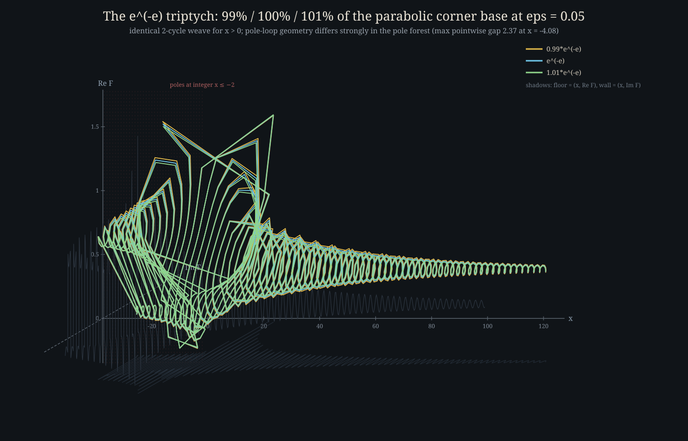
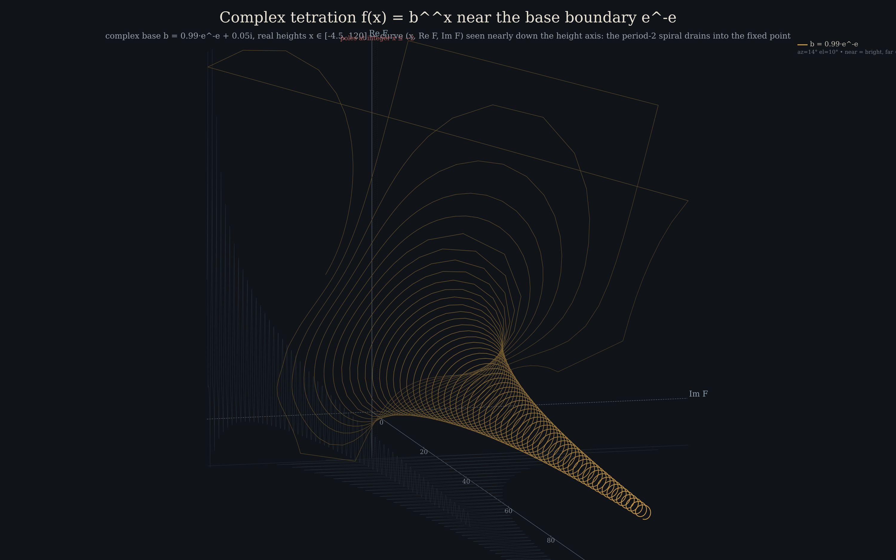

# `tet` — arbitrary-precision complex tetration

## 0. To the Tetration Forum — first, the credits

**This work exists because of, and for, the
[Tetration Forum](https://tetrationforum.org) community.** Nearly two
decades of open mathematics on that forum — constructions, proofs,
counterexamples, working code, and honest negative results — are the
foundation this implementation stands on. Before anything else, credit
where it belongs:

* **[bo198214 (Henryk Trappmann)](https://tetrationforum.org/member.php?action=profile&uid=1)** —
  founder of the forum, and co-author of the uniqueness theory for
  holomorphic Abel functions at complex fixed-point pairs that makes
  "*the*" canonical tetration a well-posed target at all.
* **Dmitrii Kouznetsov** — the Cauchy-integral construction
  (Math. Comp. 2009), developed and stress-tested in the open on the
  forum: the computational heart of this repository until November 2026,
  and still its fallback and its independent cross-check.
* **[sheldonison (Sheldon Levenstein)](https://tetrationforum.org/member.php?action=profile&uid=42)** —
  [fast accurate Kneser sexp algorithm](https://tetrationforum.org/showthread.php?tid=486),
  the [fatou.gp / merged-fixed-point program](https://tetrationforum.org/showthread.php?tid=1017),
  and the [complex-base tetration program](https://tetrationforum.org/showthread.php?tid=729)
  — for years the practical gold standard this project measures
  itself against. The theta-mapping solvers of § 6.8 and § 6.10 are
  built on the idea of those programs.
* **[mike3](https://tetrationforum.org/member.php?action=profile&uid=56)** —
  the [Cauchy Integral Experiment](https://tetrationforum.org/showthread.php?tid=359)
  and [tetration for ALL bases, real and complex](https://tetrationforum.org/showthread.php?tid=828)
  threads, which map exactly the "cover the whole base plane"
  ambition (including the cut segment) pursued here.
* **[andydude (Andrew Robbins)](https://tetrationforum.org/member.php?action=profile&uid=2)** —
  the natural slog / Abel-matrix approach and
  [Designing a Tetration Library](https://tetrationforum.org/showthread.php?tid=146).
* **[Gottfried Helms](https://tetrationforum.org/member.php?action=profile&uid=9)** —
  the matrix (Carleman) operator school, including
  [fixpoint comparisons](https://tetrationforum.org/showthread.php?tid=83)
  directly relevant to this repo's fixed-point-pair machinery.
* **[jaydfox (Jay D. Fox)](https://tetrationforum.org/member.php?action=profile&uid=7)** —
  [accelerated slog via Abel-matrix inversion](https://tetrationforum.org/showthread.php?tid=1203).
* **[JmsNxn (James Nixon)](https://tetrationforum.org/member.php?action=profile&uid=163)** —
  the β-method and infinite-composition theory, and much of the
  forum's modern analytic energy.
* **[tommy1729](https://tetrationforum.org/member.php?action=profile&uid=47)**,
  **Ember Edison**, **MphLee**, and the many members whose questions,
  conjectures, and counterexamples shaped what "getting it right"
  means for every regime handled below.
* **William Paulsen & Samuel Cowgill** — whose complex-base papers
  grew from and fed back into these community discussions; the
  two-fixed-point formulation used in § 6.10 is the one of those papers.

This repository's companion thread on the forum is
[Arbitrary Tetration in rust](https://tetrationforum.org/showthread.php?tid=1826)
(Computation board) — discussion, bug reports, and mathematical
critique are most welcome there or via GitHub issues.

---

**Tetration** `F_b(h)` — the analytic extension of the tower
`b^(b^(b^…))` of height `h` — for **complex bases** and **complex
heights**, using request-sized arbitrary-precision arithmetic in Rust.
Coverage is incomplete, and working precision is not a certified error bound.

```console
$ tet --quiet 50 2 0 0.5 0    # base 2, height 1/2
1.4587818160364217006839716610385871352966066053309
0

$ tet --quiet 20 0.5 0 0.5 0  # real base below one; genuinely complex result
0.62978622839612487196
0.21786186312508402837
```

The solver portfolio attempts the method appropriate to each regime: special cases, Schröder
regular iteration at the attracting fixed point, a Kneser theta-mapping solver
for real bases above `e^{1/e}` (§ 6.8), its two-sided form for complex,
negative and cut bases whose two primary fixed points repel (§ 6.10), and,
as fallbacks, Kouznetsov's Cauchy-integral construction, warm-started
continuation and the ε-continuation walker for the cut segment `0 < b < e^{−e}`.
The inverses in the height (super-logarithm, `--slog`) and in the base
(super-root, `--sroot`) are built on the same evaluators (§ 6.9).
Unchecked Richardson and linear-surrogate answers have been removed.
Finite-value, convergence, normalization and functional-equation checks reject
known failures. These checks do **not** prove forward accuracy, uniqueness, or
global canonicality; the functional equation can hold for a wrong reconstruction.
The base-2 example agrees with an independent-method numerical reference to
100 digits; real heights of real bases above `e^{1/e}` now return an exactly
zero imaginary part.

* **Language / deps:** Rust, [`rug`](https://crates.io/crates/rug)
  (GMP/MPFR/MPC bindings) for arbitrary-precision complex arithmetic,
  [`rayon`](https://crates.io/crates/rayon) for parallel kernels.
* **Interface:** a single CLI binary `tet`, plus a string-in/string-out
  library API (`tetration::tetrate_str`, `slog_str`, `sroot_str`).
* **Definition used:** `F_b(0) = 1`, `F_b(z+1) = b^{F_b(z)}`, with
  method-specific branch and normalization conventions
  (§ [Conventions](#12-conventions-and-normalization)).
* **Status (14 November 2026, night):** the base `e^{1/e}` itself is
  computed, at every height and with `--slog` and `--sroot`:
  `tet 40 eta 0.5` is `1.257153075054172622171646564771545603158`, in
  milliseconds (§ 6.11). Its fixed point `e` is parabolic, and the
  tetration is the inverse of the Fatou coordinate of that fixed point: the
  common limit of regular iteration below `e^{1/e}` and of the Kneser
  tetration above it. The other bases with a neutral fixed point, `e^{−e}`
  among them, are refused at once instead of running without end: there
  regular iteration degenerates to the fixed point, and the two-fixed-point
  tetration, which passes them, is beyond the present solver (§ 8).
  `--sroot` takes `e^{1/e}` for an end of its bracket: a real root below
  it is found by regular iteration alone, without the bases just above
  it, which no solver reaches (§ 6.9).
* **Status (14 November 2026):** each of the two numbers of a run can be
  one complex argument, `tet 30 1.5+0.5i 1+0.7i`, next to the four real
  ones of `tet 30 1.5 0.5 1 0.7`; of four arguments each must now be real
  (§ 3.2). At complex heights, and at real heights between `−2` and `−1`,
  regular iteration now proves the branch of every logarithm of its height
  reduction, where it judged the distances of its samples before (§ 6.3).
  The values are the same; heights as close to `−2` as `10⁻²⁹`, which were
  refused, have values.
* **Status (13 November 2026):** a correctness fix and several extensions.
  Regular iteration chose the principal logarithm at every step of its
  height reduction, which is the wrong branch once `F(h + s)` has gone
  around 0: next to the Shell–Thron boundary the printed values jumped
  along the real height axis (base `1.7646 + 0.1690i`, heights `0.56 … 0.60`).
  The branches now follow the tetration continuously, and at real heights
  every one of them is checked against the integer tower (§ 6.3). Also new:
  regular iteration sums its inverse series on most of the disk where it
  converges, which carries it to `|λ| = 0.99999` (9 minutes; `0.9999`:
  45 s; `0.998`: 0.3 s) and
  makes cut-side bases such as `0.066` three times faster than before;
  real bases next to `e^{1/e}` are 10 to 20 times faster (`1.4448`: 13 s
  at 15 digits, 210 s before; `1.44467` finishes); heights far to the left
  and integer towers of astronomical height end in closed form or by
  exact cycle detection; complex bases next to the boundary are solved from
  outside down to `|λ| = 1.001`; a failed regular iteration is an error, no
  longer a value of the two-fixed-point function; `--slog` covers real
  targets of cut bases, very large targets and targets next to singular
  heights; `--sroot` covers negative heights and is 2 to 4 times faster on
  complex inputs. Later the same day: the two-sided solver sums long
  inverse series too and raises its contour on the cut (§ 6.10), so complex
  bases just outside the boundary take seconds down to `|λ| − 1 = 10⁻¹²`
  (`1.0005`: 4 s, 100 s before; `1.0002` did not finish before) and cut
  bases are solved up to `0.0659` (`0.065`: one minute; no result before);
  a real base is shown to need no branch tracing (§ 6.3); and the four
  numbers of the command line may be named constants and constant
  expressions, tetration included, computed to the precision of the run
  (§ 3.2).
* **Status (November 2026):** real bases above `e^{1/e}` are solved by a
  theta-mapping iteration whose cost grows linearly with the digits:
  `2^^0.5` takes 0.3 s at 15 digits (41 s before) and matches the independent
  reference to 100 digits in 7 s; 400 digits take 7 minutes on one thread.
  It also reaches bases the Cauchy solver did not: `b = 1.6`, the
  near-parabolic `1.46` and `1.4448`, and `10^10000`. Its two-sided form
  solves complex and negative bases outside the Shell–Thron region in about a
  second at 15 digits (the Cauchy solver needed a minute or failed, e.g. at
  `−2` and `−0.8+0.4i`) and, for the first time, the cut bases
  `0 < b < e^{−e}` directly (`0.04`: 3 s). `--slog` and `--sroot` are new.
* **Status (October 2026):** direct inverse-Poincare series extend strictly
  attracting coverage, including independently checked 100-digit boundary-band
  values, 1000-digit complex-height results and a 100,000-digit native-scale
  fractional-height witness. Taylor jumps now accelerate real positive and
  genuinely complex near-neutral attractors without changing the regular family.
  Coverage is not universal or globally certified.
  Some neutral, negative-real, general-complex and
  cut-base cases remain unsupported. See [`FAILURE_CASES.md`](FAILURE_CASES.md)
  and [`updates.md`](updates.md); August success claims are historical, not
  current accuracy guarantees.
* **Rules for every change (§ 7.1):** a result is a value the algorithm has
  converged to at the requested precision, never an interpolation,
  extrapolation or other approximation; every intermediate value carries at
  least the requested precision; where that cannot be had, the answer is an
  error.
* **License:** AGPL-3.0-only.

---

## Table of contents

0. [To the Tetration Forum — first, the credits](#0-to-the-tetration-forum--first-the-credits)
1. [Mathematical background](#1-mathematical-background)
   1. [What tetration is](#11-what-tetration-is)
   2. [Conventions and normalization](#12-conventions-and-normalization)
   3. [The base-plane geography: Shell–Thron](#13-the-base-plane-geography-shellthron)
2. [Building from source](#2-building-from-source)
3. [Command-line usage](#3-command-line-usage)
   1. [The inverse modes: super-logarithm and super-root](#31-the-inverse-modes-super-logarithm-and-super-root)
   2. [Constants and expressions in the arguments](#32-constants-and-expressions-in-the-arguments)
   3. [Web page and HTTP API](#33-web-page-and-http-api)
4. [Library usage](#4-library-usage)
5. [Coverage map](#5-coverage-map)
   1. [✅ Verified](#51--verified)
   2. [⏳ Pending / in progress](#52--pending--in-progress)
   3. [❌ Known-bad / missing](#53--known-bad--missing-by-design-or-documented-ceiling)
   4. [Gallery: the cut segment in 3D](#54-gallery-fx--bx-near-the-cut-in-3d)
6. [The algorithms, in detail](#6-the-algorithms-in-detail)
   1. [Classification](#61-classification-fixed-points-and-)
   2. [Exact cases](#62-exact-cases)
   3. [Schröder regular tetration](#63-schröder-regular-tetration-shellthron-interior)
   4. [Kouznetsov Cauchy-integral method](#64-kouznetsov-cauchy-integral-method-outside-shellthron)
   5. [Continuation solver](#65-continuation-solver)
   6. [Retired polynomial fallback](#66-retired-polynomial-fallback)
   7. [The cut-base ε-walker](#67-the-cut-base-ε-walker-0--b--e−e)
   8. [Kneser theta-mapping solver](#68-kneser-theta-mapping-solver-real-b--e1e)
   9. [Inverses: super-logarithm and super-root](#69-inverses-super-logarithm-and-super-root)
   10. [Two-sided theta mapping: complex, negative and cut bases](#610-two-sided-theta-mapping-complex-negative-and-cut-bases-srckneser_complexrs)
   11. [The base `e^{1/e}` itself: a parabolic fixed point](#611-the-base-e1e-itself-the-fatou-coordinate-of-a-parabolic-fixed-point-srcparabolicrs)
7. [Numerical honesty](#7-numerical-honesty)
   1. [Rules for every change](#71-rules-for-every-change)
8. [Known limitations](#8-known-limitations)
   1. [Feasibility verdicts for the open gaps](#81-how-hard-would-closing-each-gap-be-feasibility-verdicts)
9. [Repository layout](#9-repository-layout)
10. [Testing](#10-testing)
11. [References](#11-references)

---

## 1. Mathematical background

### 1.1 What tetration is

Tetration is the fourth hyperoperation: iterated exponentiation. For a
non-negative integer height `n`,

```
b^^0 = 1,   b^^(n+1) = b^(b^^n)
```

so `2^^3 = 2^(2^2) = 16`. The interesting problem — the one this
project addresses — is extending `h ↦ b^^h` to **arbitrary complex
heights** `h` and **arbitrary complex bases** `b`, holomorphically,
satisfying

```
F_b(0) = 1        (normalization)
F_b(z+1) = b^F_b(z)   (the Abel / functional equation, "FE")
```

The FE and normalization alone do not determine a unique function:
reparameterizations `h ↦ h+p(h)` with suitable 1-periodic `p` preserve the FE.
Kneser-type uniqueness requires additional analytic hypotheses, not just
agreement of two numerical runs. For example, Trappmann–Kouznetsov's Abel
criterion requires an injective holomorphic Abel function on an initial
region, a normalization, and coverage of the complex plane by integer
translates of its image. This implementation does not verify that criterion.
For the real-base Kneser construction above `e^{1/e}`, the selected solution
is real on `h ∈ (−2,∞)` and has specified limiting fixed points.

### 1.2 Conventions and normalization

Precise statements of what `tet` returns:

* **Normalization:** `F_b(0)=1`, `F_b(1)=b`, `F_b(−1)=0` for nondegenerate
  bases. A finite `F_b(−2)` would require an exponential to equal zero, so
  it cannot exist. The program rejects integer heights `≤−2`; it does not
  return an infinity as a successful complex value. Base one is a separate
  constant-function convention, including at negative heights.
* **Branches:** `b^z=exp(z·Log(b))` uses the principal base logarithm.
  Regular iteration is single-valued in the half-plane `|λ^{h+2}| < 1` of
  heights (for a real base between 1 and `e^{1/e}`: `Re h > −2`), which
  contains every real height above `−2`: there the logarithms of the height
  reduction are those that keep `F(h + s)` continuous in the real shift
  `s` (§ 6.3), whatever their branch. At real heights above `−1` each of
  them is checked against the integer tower; at every other height of the
  half-plane each of them is proved to be that one. Outside that half-plane,
  where the tetration is many-valued, height reduction uses principal logs.
  The theta mappings trace their branches as described in § 6.10. The
  tetration of the base `e^{1/e}` itself is single-valued on the plane of
  heights cut along `h ≤ −2`, and the principal logs are its continuation
  there (§ 6.11). For the other bases a global single-valued function on
  all heights is not claimed.
* **Real bases above one:** regular attracting iteration is used where
  available below `e^{1/e}`; the Kneser-type Cauchy construction is used
  above it. Real-height reality checks apply on the relevant real domain,
  not to every real base or every height.
* **Real bases below one:** the selected regular branch is generally
  complex at noninteger real heights because `λ^h` has `λ<0`. For example,
  `F_0.5(0.5)≈0.6297862284+0.2178618631i`; forcing its imaginary part to zero
  is incorrect. This specifies the chosen regular branch, not a
  nonexistence theorem about every other possible real interpolation.
* **`Im(b)<0`:** the dispatcher defines the reflected branch by
  `F_b(h)=conj(F_conj(b)(conj(h)))`.
* **Complex and negative bases:** where the fixed point `−W₀(−ln b)/ln b`
  attracts, the regular iteration at it; where it repels, the function that
  tends to the two primary fixed points `−W₀(−ln b)/ln b` and
  `−W₁(−ln b)/ln b` as `Im z → ±∞` (§ 6.10). The second family continues the
  Kneser tetration of real `b > e^{1/e}` analytically through the upper half
  base-plane; it is not the continuation of the first across the boundary.
* **Cut segment `0<b<e^{−e}`:** the limit of that second family from the
  upper half base-plane, computed at the real base itself with the same two
  fixed points. Values at real non-integer heights are complex.
* **Integer heights:** direct MPFR/MPC tower iteration, not exact symbolic
  arithmetic in general. Exact representable cases such as `2^^3=16`
  remain exact; exponent-range overflow/underflow is an error.

### 1.3 The base-plane geography: Shell–Thron

For the map `f(z) = b^z`, a distinguished fixed point is

```
L = −W₀(−ln b) / ln b,     with multiplier   λ = f'(L) = L · ln b
```

where `W₀` is the principal Lambert W branch. The **Shell–Thron
region** is the set of bases with `|λ| ≤ 1` — a cardioid-like domain
in the base plane. Its boundary crosses the real axis at
`η = e^{1/e} ≈ 1.44467` (where `λ = 1`, the parabolic case famous from
`b^^∞` convergence) and at `e^{−e} ≈ 0.06599` (where `λ = −1`, the
period-doubling point). The geography drives everything:

| where `b` lives | dynamics at `L` | natural method |
|---|---|---|
| Shell–Thron interior (`\|λ\| < 1`) | attracting | Schröder linearization |
| the base `η = e^{1/e}` (`λ = 1`) | parabolic | Fatou coordinate of the fixed point `e` (§ 6.11) |
| the rest of the Shell–Thron boundary (`\|λ\| = 1`) | root-of-unity or irrationally neutral | sectorial Fatou coordinates / small-divisor analysis; not implemented (§ 8) |
| outside, real `b > η` | repelling, conjugate FP pair | Kneser theta mapping (Kouznetsov Cauchy integral as fallback) |
| outside, general complex `b` | both primary fixed points repel | two-sided theta mapping (Kouznetsov Cauchy integral as fallback) |
| real cut `0 < b < e^{−e}` | repelling with `λ < −1` | two-sided theta mapping (ε-continuation walker as fallback) |

---

## 2. Building from source

The project is plain Cargo, but `rug` compiles the GNU bignum stack
(GMP, MPFR, MPC) from source the first time, which needs a C toolchain.

### 2.1 Prerequisites

* **Rust** stable compatible with `Cargo.lock` (no tested minimum version is declared): install via
  [rustup.rs](https://rustup.rs) —
  `curl --proto '=https' --tlsv1.2 -sSf https://sh.rustup.rs | sh`
* **C toolchain + m4** (for the `gmp-mpfr-sys` build):
  * Debian/Ubuntu: `sudo apt install build-essential m4 diffutils`
  * Fedora: `sudo dnf install gcc make m4 diffutils`
  * macOS: `xcode-select --install` (m4 ships with the CLT)
  * Windows: use **WSL** (the MSVC target is not supported by
    `gmp-mpfr-sys`; MinGW works but WSL is the documented path)

### 2.2 Build, test, install

```console
$ git clone https://github.com/lukaszgryglicki/claude-tetration
$ cd claude-tetration
$ cargo build --release          # first build compiles GMP/MPFR/MPC: ~2-5 min
$ ./target/release/tet --quiet 50 2 0 3 0
16
0
```

Run the test suite (release mode strongly recommended — the numeric
tests are heavy):

```console
$ TET_MT=4 cargo test --release --all-targets -- --test-threads=1
$ cargo test --release --lib     # just the fast unit tests
```

Optionally place the binary on your `PATH`:

```console
$ cargo install --path .         # installs `tet` into ~/.cargo/bin
```

No configuration files, no runtime dependencies beyond the shared
system libc: the bignum stack is statically linked into the binary.

The repository also provides a Makefile compatible with GNU make and BSD make.
Plain `make`, `make build` and `make release` build the release executable;
`make help` lists all targets:

| Targets | Purpose |
| --- | --- |
| `debug`, `static`, `examples` | Debug, fully static native, or all example builds |
| `test`, `test-lib`, `test-rust`, `test-python`, `test-doc` | Default Rust/Python/doc battery or individual layers |
| `test-st`, `test-ignored`, `test-all` | Serial Rust tests, ignored cases only, or the entire battery including ignored cases |
| `fmt`, `fmt-check`, `vet`/`lint`, `check`, `verify`, `doc` | Formatting, Clippy, compile checks, combined checks, and API documentation |
| `demo`, `run`, `grid`, `edge`, `test-w0` | One bounded 50-digit demo, custom CLI calls, TSV sweeps, or Lambert W diagnostics |
| `chartgen`, `plot`, `gallery` | Existing CSV sampler, SVG renderer, and gallery script |
| `install`, `install-static`, `clean` | Install `tet` into `/data/scripts`, or remove Cargo outputs without deleting charts/data |

```console
$ make demo
$ TET_MT=4 make test
$ make test-lib TEST_ARGS='--test-threads=1'
$ make run ARGS='--quiet 50 1.2 0 0.4 0.2'
$ make grid ARGS='50 1 1.3 1.3 0.1 0.1 0.5 0.5 0 0'
$ make chartgen ARGS='1 0 /tmp/tet.csv coarse'
$ make plot ARGS='--help'
$ make install                      # /data/scripts/tet
$ sudo make install                 # or sudo gmake install, if write access requires sudo
$ make install BINDIR="$HOME/.local/bin"
$ make install DESTDIR=/tmp/stage    # staged /tmp/stage/data/scripts/tet
```

`JOBS=2` and one Rust test thread are the defaults; `TET_*` runtime settings
are inherited unchanged. Use `ARGS` for CLI/example/script arguments,
`TEST_ARGS` for Rust test-harness arguments, and `CARGO_TARGET_DIR` for another
build directory (also honored by `chartgen`). Full grids, edge sweeps and
ignored tests can be expensive; `gallery` deliberately rewrites its existing
gallery outputs and is never run by the default build or demo.

`make static` produces `target/<native-Rust-target>/release/tet`, including
the C runtime (for example `target/x86_64-unknown-linux-gnu/release/tet`).
It requires a toolchain supporting static CRT linking, its static system
libraries and `file`; it fails if the output is not actually static.
The native target comes from `rustc -vV` (`RUSTC` is configurable).
FreeBSD static builds suppress Clang's unused-driver-argument warning for
Rust's redundant `-no-pie` alongside `-static`; other linker warnings and
errors, caller `RUSTFLAGS`, and the actual static-executable check remain.
Cross-compilation, including GNU-to-musl, is not configured: the current
GMP dependency rejects it without additional feature changes.
`install-static` installs the static executable instead of the normal release
binary. Both install targets support `BINDIR` and `DESTDIR`; they install into
the filesystem of the machine running Make.

### 2.3 First-run sanity checks

```console
$ tet 50 2 0 3 0        # integer tower: exactly 16
$ tet 20 2.718281828459045235 0 0.5 0    # e^^0.5 ≈ 1.6463542337...
$ tet 20 1.4142135623730950488 0 0.5 0    # √2, inside Shell-Thron
1.2436216276685218043
$ tet 20 0 1 0.5 0      # base i
1.1667009135704745693
0.73456353698672132966
```

---

## 3. Command-line usage

```
tet [--quiet|--silent|-q] <precision_digits> <base_re> <base_im> <height_re> <height_im>
tet [-q] --slog|--ate   <precision_digits> <base_re> <base_im> <value_re> <value_im>
tet [-q] --sroot|--ssrt <precision_digits> <value_re> <value_im> <height_re> <height_im>
tet [-q] <precision_digits> <base> <height>
tet [-q] --slog|--ate   <precision_digits> <base> <value>
tet [-q] --sroot|--ssrt <precision_digits> <value> <height>
```

* `precision_digits` — requested decimal precision (positive integer).
  Internally mapped to MPC binary precision with guard bits.
* the remaining arguments are two complex numbers. With four arguments each
  number is its real part followed by its imaginary part: without a flag
  the base `b = base_re + i·base_im` and the height
  `h = height_re + i·height_im`. With two arguments each number is one
  complex argument: `tet 30 1.5 0.5 1 0.7` and `tet 30 1.5+0.5i 1+0.7i` are
  the same run, and so are `tet 50 2 0 3 0` and `tet 50 2 3`.
* each argument is a decimal number or a constant expression such as `pi`,
  `e^(1/e)` or `2^^0.5`, computed to the precision of the run (§ 3.2). Of
  four arguments each must be real: a complex one is an error, and `re(z)`
  is the real part of anything.
* `--slog` (alias `--ate`) takes the base and a value and prints the height
  `h` with `F_b(h) = value`; `--sroot` (alias `--ssrt`) takes a value and
  the height and prints the base `b` with `F_b(h) = value`. § 3.1 explains
  the arguments and how to read the results; the methods are in § 6.9.
  Without a flag the behaviour and output are unchanged.

**Output:** two lines on stdout — the real part, then the imaginary part, of
`F_b(h)` (of the height with `--slog`, of the base with `--sroot`). Each
number carries the requested count of significant digits. Magnitudes below 1,
and those too large for that many digits, are written with an exponent:
`5.0000000000000000000e-1` is `0.5`. An exact zero is printed as `0`.

**Exit codes:** `0` success; `1` honest failure (diagnostic on stderr);
`2` usage error.

Detailed algorithm and iteration diagnostics go to stderr **by default**.
Quiet flags or a truthy `SILENT` suppress progress, never fatal errors.

**Precision and resources.** Significant digits and magnitude are independent:
`10^^3 = 10^(10^10)` can be returned with 100,000 significant digits. The
engine uses Rug's 64-bit precision APIs and widens MPFR's exponent range on
every calling/worker thread to the library's supported extrema. On the tested
64-bit build those binary exponent bounds are
`[-4611686018427387903, 4611686018427387903]`, and the native precision maximum
is `9223372036854775551` bits. Actual memory is exhausted far earlier; no
additional digit cap is inferred from the exponent range.

Mathematical values, tolerances, unbounded iteration counters and exact
coefficients use arbitrary precision. π, e, logarithms and derived thresholds
are computed at working precision, not read from native constants or fixed-digit
tables. Only bounded indexes, native-library metadata and display/timing
bookkeeping use native types. Rust API precision arguments are `u64`.

There are no fixed application node, series-order, iteration, height-shift,
continuation-step or per-value time budgets. Sizes follow precision and geometry,
with native addressability checks; slow but improving solves may run for hours.
Repeated states, unrepresentable updates, invalid branches and failed numerical
gates still cause honest refusal. `TET_KOUZ_PATIENT` is no longer needed.
Removing budgets does not establish convergence or canonical coverage.

Use `cnum::format_float`, `format_complex`, `DisplayFloat` or `DisplayComplex`
for wide-exponent values. These format the significand and exponent separately;
Rug 1.30's ordinary formatter can attempt exponent-sized allocations.

The checked complex exponential uses outward-rounded, binary-scaled MPFR
component bounds, refining until their returned rounding agrees. This avoids
MPC 1.4.1's component-underflow loop, tiny-input precision allocations and
premature magnitude overflow when both components still fit. This certifies
the primitive's rounding, not tetration's global forward error. Native-range
and ordinary MPC-comparison regressions are in
[`tests/phase11_resources.rs`](tests/phase11_resources.rs).

`cnum::ln_complex` also avoids MPC's excessive refinement for `1+i*y` when
guarded precision exceeds the precision of a tiny dyadic input: exact squaring,
MPFR `log1p(y*y)/2` and `atan(y)` retain both components. Other inputs and the
native exponent edge retain MPC's principal logarithm. Fixed-point
classification uses the identity `L=exp(-W_0(-Log(b)))`, avoiding an ill-scaled
division near base one. These changes do not replace the numerical libraries.

Local reproducibility archive:
`~/tetration-resource-limits-2026-10-04-artifacts/`, including source/binaries,
raw logs and `limits-reference-check.json` (external-reference consistency).
The corrected source/executable hashes are in `limits-post-geometry/manifest.json`;
`limits-post-geometry-runtime-result.json` records 78 passing release/static/
FreeBSD ST/MT output and precision checks. The frozen regression ledger
(`limits-post-geometry-progress.json`) has 203 of 206 passing tests. The three
unfinished regressions (`t423`, `t870`, `t872`) were stopped at the user's request
and remain **unverified, not passed**; none were disabled or weakened.
`limits-post-geometry-cancellations.json` preserves the cancellation provenance.
Completed 118/130-digit constructions match
corroborated external data for `2^^0.5` at their respective precisions.
The actual `2^^5.1` real outputs round identically at 110 significant digits
(empirical relative agreement: 118.35 digits), with relative imaginary components
below `4.71e-128`. `limits-post-geometry-high-comparison.json` preserves these
checks, actual outputs and hashes. Cross-precision agreement is not a global
forward-error or canonicality certificate.
The final handoff is `~/tetration-resource-limits-2026-10-04-1.md`;
`limits-resource-final/manifest.json` in the archive records the final source,
patch and evidence identities. That resource-audit handoff precedes the
coverage work described in §5.

The resource audit also exposed lost digits after finite height shifts:
`2^^5.375` at 40/60 digits agreed to only 28.87 digits, although both recurrence
residuals were zero (`limits-range-baseline-comparison.json` in that archive).
Integer, Schroder and Kouznetsov evaluation now refine internal precision
against a fixed output-digit goal, including tiny near-singular outputs and
large imaginary phases. Decimal inputs are reparsed when refinement requires it.
Kouznetsov also refines contour/normalization accuracy while preserving the
selected fixed-point pair and log sheet. Regression coverage includes actual
40/60/80-digit comparisons. The corrected-source 40-digit large-height regression
passes (`limits-post-geometry-conditioning-40.json`); its cross-precision seed
and the conditioning estimates are not independent canonicality certificates.

Contour sizing uses the slower of both fixed-point tails. Automatic EM order
now depends on spacing, scale and working precision, with optimal asymptotic
truncation rather than a fixed order budget. At a 130-digit near-endpoint
constant-Cauchy identity, this reduced error from `5.17e-104` to `7.00e-146`,
below the `1e-133` target (`limits-geometry-library.log` in the archive).
That quadrature witness does not certify the complete tetration construction.

| variable | effect |
|---|---|
| `SILENT=1` | suppress progress diagnostics; fatal errors remain on stderr |
| `TET_CAUCHY=1` | skip the theta-mapping solvers (§ 6.8, § 6.10) in the forward dispatcher and use the Cauchy path, for A/B comparison; slow, and fails where that path always failed |
| `TET_KOUZ_ANDERSON=1` / `TET_KOUZ_PICARD=1` | force alternative Kouznetsov iterators (diagnostics) |
| `TET_KOUZ_NO_EM=1`, `TET_KOUZ_EM_K=<n>` | Euler–Maclaurin correction A/B switches |
| `TET_KOUZ_CUT_ANCHOR=<ε₀>`, `TET_KOUZ_CUT_RATIO=<r>` | positive anchor (default 2), ratio strictly between 0 and 1 (default 0.72); unaddressable schedules are rejected |
| `TET_KOUZ_CUT_CKPT=<file>` | atomic full-precision `TETCKPT2` checkpoints; exact base/precision/geometry matching is required. Corrupt, incompatible `TETCKPT1`, and I/O failures are errors, not silent cold starts |
| `TET_KOUZ_UNWRAP_DEBUG=1` | branch-unwrap winding diagnostics |
| `TET_KOUZ_RESID_DUMP=<prefix>` | full-precision residual profiles under the supplied prefix; collisions and I/O failures are reported |
| `TET_MT=<n>` | unset/empty/`0`: serial; `1`: available cores; `n ≥ 2`: exactly `n` threads. Invalid settings or an already-initialized conflicting Rayon pool are errors, including for library callers |

**MT mode.** Big-number tetration is dominated by one hot loop: the FFT-based
Newton–Krylov matvecs inside the Kouznetsov solver (measured ≈ 90 % of a
20-digit cut-adjacent solve). With `TET_MT` set, the radix-2 FFT runs its
butterflies in parallel over disjoint index pairs, and the per-node
transcendental maps (`b^F`, branch logs, boundary corrections) run as parallel
element-wise maps. **No floating-point accumulation is ever reordered** —
GMRES inner products, norms and Euler–Maclaurin sums stay serial, and each
parallel output element is produced by the same correctly-rounded MPC
operations on the same operands in the same order as the serial code. MT-mode
results are therefore bit-identical to the default, verified by A/B `diff` on
Kouznetsov, Schröder and complex-base cases. Speedup is workload-dependent:
grids of `n = 4096–32768` nodes at modest precision parallelize well; tiny
grids and pure-Schröder evaluations gain little. Measured on a 16-core box
(`tet 30 2 0 0.5 0`, a historical 30-digit Kouznetsov solve, machine under background
load, values `diff`-identical): serial 732 s → `TET_MT=4` 362 s (2.0×) →
`TET_MT=16` 167 s (**4.4×**). These timings are not current performance
guarantees. The retired Richardson ladder no longer launches parallel solves.

Examples:

```console
$ tet --quiet 10 -2 0 0.4 0.1           # explicit unsupported/residual error,
                                       # nonzero exit, no numeric stdout

$ SILENT=1 tet 20 1.4142135623730950488 0 0.5 0   # √2, quiet mode
1.2436216276685218043
0

$ tet -q 20 0.04 0 0.5 0                # a base on the cut 0 < b < e^-e (3 s)
6.6383135523147452465e-2
4.4794486192426514996e-1

$ tet -q 20 -2 0 0.5 0                  # a negative base (2 s)
1.2349920471100180674
1.7276518625932047103

$ tet -q --slog 30 2 0 16 0             # super-logarithm: 2^^3 = 16
3.00000000000000000000000000000
0

$ tet -q --sroot 30 2 0 2 0             # super square root of 2: b^b = 2
1.55961046946236934997038876877
0

$ tet -q --sroot 20 10 0 2.5 0          # the base with b^^2.5 = 10 (about 15 s)
2.1179975403097240013
0
```

### 3.1 The inverse modes: super-logarithm and super-root

All three modes are about one equation, `b^^h = z` (that is, `F_b(h) = z`),
between a base `b`, a height `h` and a value `z`. Each mode takes two of the
three and prints the third. The first argument is always the number of
digits. Then come two complex numbers, each as its real part followed by its
imaginary part, or each as one complex argument (§ 3.2). The answer is
printed as two real numbers: real part on the first line, imaginary part on
the second.

| mode | command line | you give | it prints | the same thing for powers |
|---|---|---|---|---|
| tetration (no flag) | `tet D b_re b_im h_re h_im` or `tet D b h` | base `b`, height `h` | the value `z = b^^h` | `z = b^h` |
| super-logarithm: `--slog` or `--ate` | `tet --slog D b_re b_im z_re z_im` or `tet --slog D b z` | base `b`, value `z` | the height `h` with `b^^h = z` | `h = log_b z` |
| super-root: `--sroot` or `--ssrt` | `tet --sroot D z_re z_im h_re h_im` or `tet --sroot D z h` | value `z`, height `h` | the base `b` with `b^^h = z` | `b = z^(1/h)` |

`--ate` ("arc-tetration") is a second name for `--slog`, and `--ssrt` for
`--sroot`; the flags take two dashes, may stand anywhere on the command line
and combine with `-q`. Note the order for `--sroot`: the **value comes
first**, the height second. Asking for both inverses at once, or giving a
wrong number of arguments, is a usage error (exit code 2). An equation with
no solution that the program can find and verify is an error with exit
code 1 and a message on stderr. `tet --help` prints the same summary of the
three modes.

The same equation, three ways:

```console
$ tet -q 30 2 0 0.5 0                  # base 2, height 0.5: the value
1.45878181603642170068397166104
0

$ tet -q --slog 20 2 0 1.45878181603642170068397166104 0     # base 2, that value: the height
5.0000000000000000000e-1
0

$ tet -q --sroot 20 1.45878181603642170068397166104 0 0.5 0  # that value, height 0.5: the base (11 s)
2.0000000000000000000
0
```

With one argument for each number the same three runs are `tet -q 30 2 0.5`,
`tet -q --slog 20 2 1.45878181603642170068397166104` and
`tet -q --sroot 20 1.45878181603642170068397166104 0.5`.

**Reading `--slog` (`--ate`) results.**

* `tet --slog 20 2 0 16 0` gives `3`: the height at which base 2 reaches
  16, because `2^^3 = 2^(2^2) = 16`. The definition fixes `slog_b(1) = 0`,
  `slog_b(b) = 1` and `slog_b(0) = −1` for every base.
* Any of the four numbers may be non-zero.
  `tet --slog 15 2 0 1.3232385095217583751 0.86933975675873261759` gives
  the height `0.5 + i` (printed as `5.00000000000000e-1` and
  `1.00000000000000`). Complex, negative and cut bases work too:
  `tet --slog 15 -2 0 5 0` gives `0.441972558639406 − 0.358412886220720i`,
  and indeed `(−2)^^(0.44197… − 0.35841…i) = 5`;
  `tet --slog 15 0.04 0 0.1 0` gives `−1.01343950923799 +
  0.134822863318788i` for the cut base `0.04`.
* A value that the tetration takes only next to one of its singular heights
  gets that height, rounded to the digits requested: for a real base above
  `e^{1/e}` very negative values approach the height `−2`
  (`tet --slog 15 2 0 -1e30 0` gives `-2.00000000000000`), and
  `tet --slog 15 0.5 0 -100 0` gives `0.750119449840629 −
  0.968029912394000i`, the limit of the heights of `−30`, `−60`, …. Such a
  height cannot be checked by computing `b^^h` again (§ 6.9).
* A real value need not have a real height. For a real base above `e^{1/e}`
  every real value has one, between `−2` and `∞`
  (`slog_2(−3) = −1.8984455450755269556`; ever more negative values approach
  the height `−2`). For `1 < b < e^{1/e}` the tetration of a real height
  stays below the lower fixed point of `b^x` (`2` for `b = √2`): a real
  value below it has a real height
  (`slog_√2(1.5) = 1.3278668758402484092`), a value between the two fixed
  points `2` and `4` has a complex one
  (`slog_√2(3) = −3.3834692659172140179 − 8.5715740896774235518i`), and a
  value beyond `4`, which that tetration never takes, has none: error.
* Tetration can take the same value at several complex heights. `--slog`
  prints one of them — the principal one, on the branch with
  `slog_b(1) = 0` (§ 6.9) — and whatever it prints has been confirmed by
  computing `b^^h` again.
* The bases `0` and `1` have no super-logarithm: error.

**Reading `--sroot` (`--ssrt`) results.**

* `tet --sroot 20 16 0 3 0` gives `2`: the base whose tower of height 3 is
  16, `b^(b^b) = 16`. With the height `2` it is the super square root, the
  solution of `b^b = z`: `tet --sroot 30 2 0 2 0` gives
  `1.55961046946236934997038876877`. With the height `1` it returns the
  value itself.
* The height need not be an integer: `tet --sroot 20 10 0 2.5 0` gives
  `2.1179975403097240013`, the base whose tetration to the height `2.5` is
  `10` (9 s). Integer heights `0`, `−1`, … are refused, because `b^^0 = 1`
  and `b^^(−1) = 0` for every base and so determine none.
* For a real value above `1` and a real height above `0` the answer is the
  real base above `1`. So it is for a value between `0` and `1` with a
  height between `−1` and `0`, and for a negative value with a height
  between `−2` and `−1`: `tet --sroot 15 0.5 0 -0.5 0` gives
  `2.68778856702334` and `tet --sroot 15 -1 0 -1.5 0` gives
  `1.75033148344121`.
* For other inputs (a value below `1`, a negative or complex value, a
  complex height) the answer is in general complex, and the equation can
  have several solutions; the one printed is the one reached by following
  the real solution as the value and the height move to those requested
  (§ 6.9). `tet --sroot 15 -1 0 2 0` gives
  `1.69038675716359 + 1.86990796402678i` (a solution of `b^b = −1`),
  `tet --sroot 15 1 1 2 0` gives `1.39401786375297 + 0.577731814002267i`
  (`b^b = 1 + i`), and `tet --sroot 15 0.75 0 2 0` gives
  `0.636262939294531`, the solution of `b^b = 0.75` above `1/e` (a second
  real one lies below).
* With a non-integer height and a complex answer, remember that this
  program's tetration is one function for bases inside the Shell–Thron
  region and another outside it (§ 1.2). The base printed satisfies
  `b^^h = z` for the function used at that base: feeding it back to `tet`
  returns the value. `tet --sroot 15 1.3 0.3 0.5 0` gives
  `1.34643520763314 + 0.718919636140968i` (8 s), and
  `tet 15 1.34643520763314 0.718919636140968 0.5 0` gives `1.3 + 0.3i` back.
* Cost: integer heights are immediate. A non-integer height needs a full
  tetration solve for every trial base: about ten seconds for real inputs,
  seconds to minutes for complex ones. A search whose bases run into the
  Shell–Thron boundary, where the two functions meet and every solve is
  slow, can take much longer and end in an error
  (`tet --sroot 15 2 0 0.5 0.5`).

In both modes the digits printed are the digits requested, provided the
inputs carry them: a value typed with 20 digits cannot fix 30 digits of a
height. When the answer is ill-conditioned the program works with more
digits internally and re-reads the inputs at that precision (§ 6.9).

### 3.2 Constants and expressions in the arguments

Each number after the precision is a decimal number, read as before, or a
**constant expression**, computed to the precision of the run. Quote it for
the shell:

```
$ tet 50 pi 0 1 0                        # b^^1 = b: pi to 50 digits
3.1415926535897932384626433832795028841971693993751
0
$ tet 30 'pi*e^e-pow(2, 0.5)' 0 1 0
46.1943053660313545855098891412
0
$ tet 20 'e^(1/e)' 0 1 0                 # the same number as eta
1.4446678610097661337
0
$ tet 20 '2^^2' 0 'tet(2, 1)' 0          # tetration inside the arguments: 4^^2
256.00000000000000000
0
$ tet 15 'ssrt(16, 3)' 0 'ate(2, 16)' 0  # the base 2 and the height 3
16.0000000000000
0
$ tet 20 '2+i' '1/2'                     # two numbers: the base 2+i, the height 1/2
1.6554245031847440638
4.6229528876468886228e-1
```

An expression is built from

* numbers (`12`, `-0.5`, `1e-30`) and the imaginary unit `i` (or `j`);
* the named constants of the first table below; the case of ASCII letters
  does not matter, a Greek alias is taken as written;
* `+ - * /`, `^` (or `**`) for the power and `^^` for tetration, and
  brackets; `−`, `×`, `·` and `÷` are read too;
* products without a sign: `2pi`, `3i`, `2(1+i)`, `(1+i)(1-i)`;
* the functions of the second table, among them tetration (`tet(b, h)`, the
  same as `b^^h`) and its inverses (`slog` or `ate`, `ssrt` or `sroot`).

There are no variables: an argument stands for one number. A leading sign
binds less than `^`, and `^` less than `^^`; both group from the right:
`-2^2 = -4`, `2^-2 = 1/4`, `2^3^2 = 2^9`, `2^^3^2 = (2^^3)^2`.

**Two numbers or four.** With two arguments after the precision each is a
complex number: `tet 20 '2+i' '1/2'` has the base `2 + i`. With four
arguments each is a real or an imaginary part, `tet 20 2 1 '1/2' 0` is the
same run, and each of the four has to be real. A complex one is refused
rather than added to its neighbour:

```
$ tet 20 '2+i' 0 '1/2' 0
error: invalid number "2+i": it is not real (imaginary part 1.000000000); each of four numbers is a real or an imaginary part: take re(...) of it, or give two complex numbers instead of four
```

`re(z)` (or `real(z)`) and `im(z)` are the parts of any expression, so
`tet 20 're(2+i)' 'im(2+i)' '1/2' 0` is that run again. A part is real when
its imaginary part is zero by construction (**Zeros** below): `abs(3+4i)`,
`sqrt(2)^3` and `(1+i)*(1-i)` are real, `exp(i*pi)` is refused in both forms
because its imaginary part cannot be told from zero, and `re(exp(i*pi))` is
`−1`. A real and an imaginary part in one argument are not a number:
`tet 20 '2 1' '0.5 0'` is an error (`an operator is missing before 1`), not
the base `21`.

The grammar, the names and their meanings are those of the plotters
[`tet-line`](https://github.com/lukaszgryglicki/tet-line) and
[`rust-opengl-complex-drawer`](https://github.com/lukaszgryglicki/rust-opengl-complex-drawer),
which read the same expressions with a variable for the function they draw
and the same constant expressions for their ranges: four real numbers, or
two complex points for the ends of a line and the corners of a rectangle,
as here. On 13 November 2026,
140 expressions with the operators, every shared function and the 42
constants had the same value here and in the drawer's `f64` parser to 12
digits, and so had 31 more with `tet(b, h)` and with values on branch cuts
(`sqrt(-4)`, `ln(-1)`, `(-8)^(1/3)`, `asin(2)`, `atanh(-2)`,
`asinh(-2i)`, …): a zero part has no sign in the plotters either, so a
negative real number lies on the same side of a cut in all three. The
differences:

* `gamma` and `fact` take real numbers only (there is no arbitrary-precision
  complex gamma function underneath), `arg(0)` is an error, and a function
  with a real second argument (`scale`, `unscale`, `powf`, `expf`) refuses
  a complex one instead of dropping its imaginary part;
* there are no `inf`, `nan` and `is_nan`-like names, because an argument is
  a finite number, and two numbers in a row are an error, not a product;
* a zero that only inexact operations produce is refused here (**Zeros**
  below) and is a rounding residue in the plotters: `exp(ln(-3))` is an
  error here and `−3 + 3.7e-16i` there;
* `atan2`, `w`, `min`, `max`, `hypot`, `agm`, `lgamma`, `digamma`, `zeta`,
  `erf`, `erfc`, `ei`, `li2` and `**` exist only here.

**Precision.** Every operation of an expression is a correctly rounded MPFR
or MPC operation, or a tetration of this library. The expression is
evaluated twice, node by node: once with every operation rounded down, and
once, with twenty more digits, with every operation rounded up. An inexact
operation therefore leaves different numbers in the two evaluations, and
their difference shows how many bits were lost. The two values have to
agree, in the real and in the imaginary part, beyond the precision at which
the run reads its inputs (the requested digits and the guard bits); where
they do not, the lost bits are added to the working precision and both
evaluations are repeated. `(pi + 1e-300) - pi` is `1e-300` to every
requested digit. This is the evidence of two different evaluations, as
elsewhere in this program, not an interval proof. A number written in an
expression is read with all its digits, as a decimal argument is (§ 4): at
ten requested digits `re(1.0…01)`, with fifty zeros before its last digit,
is still not `1`, so a base next to `1` is not rounded to the base `1`.

**Zeros.** A part that both evaluations share is exact, and a zero is kept
as an exact zero where it is exact by construction: a sum of exact numbers
(`1/4 + 1/4 - 1/2`), a product with an exact zero factor (`pi*i` has the
real part `0`), a function of a number on an axis (`sqrt(-pi)`,
`sin(i*pi)`). A real expression of real operations has the imaginary part
`0`. A zero made of inexact operands is not trusted (`pi - pi`,
`sqrt(2)^2 - 2`), and neither is a part whose two evaluations have no digit
in common (`sin(pi)` is positive in one and negative in the other): the
digits are more than doubled, and after three such attempts in a row the
argument is refused:

```
$ tet 20 'sin(pi)' 0 1 0
error: invalid number "sin(pi)": the value cancels below every precision tried (if it is zero, write 0)
```

**Branch cuts.** A number exactly on a branch cut gets the value that
continues the function counter-clockwise around the branch point, as in
Mathematica and mpmath: `sqrt(-4) = 2i`, `ln(-1) = pi i`,
`(-8)^(1/3) = 1 + 1.732...i`, `asin(2) = pi/2 - 1.3169...i`,
`acos(2) = 1.3169...i`, `atanh(2) = 0.5493... - (pi/2) i`. `cbrt` and
`root` are principal values too: `cbrt(-8)` is `1 + 1.732...i`, not `-2`.

**Tetration inside an argument** is computed by the library itself, not by
another process, with the domain and the failures of the mode it names:
`ate(2+i, 1000-500i)` is refused exactly as `tet --slog 50 2 1 1000 -500`
is (§ 3.1). It is computed twice, for the two evaluations, with about 26
and 46 digits more than the run requests, because an argument has to be
right to the working precision of the computation that uses it:
`tet 50 '2^^0.5' 0 1 0` prints the 50 digits of `tet 50 2 0 0.5 0` and
takes 12 s instead of 2 s.

**The constants.** A name stands for the constant at whatever precision
the run reads it: `tet 1000 pi 0 1 0` prints a thousand digits of π. π,
ln 2, Euler's constant and Catalan's constant are MPFR's; closed forms are
evaluated with correctly rounded functions and guard bits; the Dottie
number, the Laplace limit and the Ramanujan–Soldner constant are Newton
iterations whose residual is checked; Khinchin's, Niven's, the
Meissel–Mertens, twin prime, Erdős–Borwein, Cahen, reciprocal Fibonacci and
Euler–Gompertz constants are series whose tails are bounded. The unit
tests compare every constant with an independent 70-digit reference and
check that its digits do not depend on the precision asked for
(`src/constants.rs`). The values below are rounded to 25 digits.

| Names | Meaning | Value |
|---|---|---|
| `pi`, `π` | circle constant | `3.141592653589793238462643` |
| `e` | Euler's number | `2.718281828459045235360287` |
| `tau`, `τ` | 2 pi | `6.283185307179586476925287` |
| `halfpi` | pi/2 | `1.570796326794896619231322` |
| `deg`, `degree` | one degree in radians, pi/180 | `1.745329251994329576923691e-2` |
| `sqrtpi`, `√π` | square root of pi | `1.772453850905516027298167` |
| `eta`, `η`, `towermax` | e^(1/e): the largest base whose infinite tower converges | `1.444667861009766133658339` |
| `towermin` | e^(-e): the smallest base whose infinite tower converges | `6.598803584531253707679019e-2` |
| `einv` | 1/e | `3.678794411714423215955238e-1` |
| `gelfond` | Gelfond's constant e^pi | `23.14069263277926900572909` |
| `gelfondschneider` | Gelfond-Schneider constant 2^sqrt(2) | `2.665144142690225188650297` |
| `ramanujan` | Ramanujan's constant e^(pi sqrt 163) | `262537412640768744.0000000` |
| `phi`, `φ`, `golden` | golden ratio (1 + sqrt 5)/2 | `1.618033988749894848204587` |
| `silver` | silver ratio 1 + sqrt 2 | `2.414213562373095048801689` |
| `plastic` | plastic number: x^3 = x + 1 | `1.324717957244746025960909` |
| `supergolden` | supergolden ratio: x^3 = x^2 + 1 | `1.465571231876768026656731` |
| `tribonacci` | tribonacci constant: x^3 = x^2 + x + 1 | `1.839286755214161132551853` |
| `sqrt2`, `√2` | square root of 2 | `1.414213562373095048801689` |
| `sqrt3`, `√3` | square root of 3 | `1.732050807568877293527446` |
| `sqrt5`, `√5` | square root of 5 | `2.236067977499789696409174` |
| `ln2` | natural logarithm of 2 | `6.931471805599453094172321e-1` |
| `ln10` | natural logarithm of 10 | `2.302585092994045684017991` |
| `gamma`, `γ`, `eulergamma` | Euler-Mascheroni constant | `5.772156649015328606065121e-1` |
| `catalan` | Catalan's constant | `9.159655941772190150546035e-1` |
| `apery`, `zeta3` | Apery's constant zeta(3) | `1.202056903159594285399738` |
| `zeta2`, `basel` | zeta(2) = pi^2/6 | `1.644934066848226436472415` |
| `omega`, `Ω` | omega constant W(1): omega e^omega = 1 | `5.671432904097838729999687e-1` |
| `dottie` | Dottie number: cos x = x | `7.390851332151606416553121e-1` |
| `lemniscate`, `ϖ` | lemniscate constant Gamma(1/4)^2/(2 sqrt(2 pi)) | `2.622057554292119810464840` |
| `gauss` | Gauss's constant 1/agm(1, sqrt 2) | `8.346268416740731862814297e-1` |
| `parabolic` | universal parabolic constant sqrt 2 + ln(1 + sqrt 2) | `2.295587149392638074034298` |
| `levy` | Levy's constant e^(pi^2/(12 ln 2)) | `3.275822918721811159787682` |
| `khinchin` | Khinchin's constant | `2.685452001065306445309715` |
| `gompertz` | Euler-Gompertz constant | `5.963473623231940743410785e-1` |
| `soldner` | Ramanujan-Soldner constant: zero of the logarithmic integral | `1.451369234883381050283968` |
| `laplace` | Laplace limit | `6.627434193491815809747421e-1` |
| `erdosborwein` | Erdos-Borwein constant: sum of 1/(2^n - 1) | `1.606695152415291763783302` |
| `cahen` | Cahen's constant | `6.434105462883380261822543e-1` |
| `recfib` | reciprocal Fibonacci constant: sum of 1/F_n | `3.359885666243177553172011` |
| `niven` | Niven's constant | `1.705211140105367764288551` |
| `mertens` | Meissel-Mertens constant | `2.614972128476427837554268e-1` |
| `twinprime` | twin prime constant | `6.601618158468695739278121e-1` |

**The functions.** `z` and `w` are complex, `x`, `y`, `r` and `t` real, `n`
whole; names in one row mean the same.

| Names | Meaning |
|---|---|
| `tet` | tet(b, h) = b^^h, tetration |
| `slog`, `ate` | slog(b, z): the height h with b^^h = z |
| `ssrt`, `sroot` | ssrt(z, h): the base b with b^^h = z |
| `sqrt` | square root |
| `cbrt` | cube root, principal value |
| `root` | root(z, n) = z^(1/n), principal value |
| `sqr`, `square` | square |
| `pow`, `powc` | pow(z, w) = z^w |
| `powf` | powf(z, x) = z^x, real x |
| `powi` | powi(z, n) = z^n, whole n |
| `powu` | powu(z, n) = z^n, whole n that is not negative |
| `exp` | exponential |
| `exp2` | exp2(z) = 2^z |
| `expf` | expf(z, x) = x^z, real x |
| `ln` | natural logarithm |
| `log` | log(z) = ln z; log(z, b) = ln z / ln b |
| `log2` | logarithm to the base 2 |
| `log10` | logarithm to the base 10 |
| `sin` | sine |
| `cos` | cosine |
| `tan` | tangent |
| `cot` | cotangent |
| `sec` | secant |
| `csc` | cosecant |
| `asin`, `arcsin` | inverse sine |
| `acos`, `arccos` | inverse cosine |
| `atan`, `arctan` | inverse tangent |
| `atan2` | atan2(y, x): the argument of x + iy, real x and y |
| `sinh` | hyperbolic sine |
| `cosh` | hyperbolic cosine |
| `tanh` | hyperbolic tangent |
| `coth` | hyperbolic cotangent |
| `sech` | hyperbolic secant |
| `csch` | hyperbolic cosecant |
| `asinh`, `arcsinh` | inverse hyperbolic sine |
| `acosh`, `arccosh` | inverse hyperbolic cosine |
| `atanh`, `arctanh` | inverse hyperbolic tangent |
| `abs`, `mag`, `mod`, `norm`, `polar_r`, `radius` | absolute value |
| `abs2`, `mag2`, `norm_sqr`, `normsq` | square of the absolute value |
| `l1_norm`, `l1`, `manhattan`, `taxicab` | \|re z\| + \|im z\| |
| `arg`, `phase`, `polar_theta`, `theta` | argument, in (-pi, pi] |
| `to_polar` | abs(z) + i arg(z) |
| `re`, `real` | real part |
| `im`, `imag` | imaginary part |
| `conj`, `conjugate` | complex conjugate |
| `inv`, `recip`, `inverse`, `finv` | 1/z |
| `sgn`, `sign`, `signum` | z/abs(z), and 0 for 0 |
| `cis` | cis(x) = cos x + i sin x, real x |
| `scale` | scale(z, x) = z x, real x |
| `unscale` | unscale(z, x) = z/x, real x |
| `fdiv` | fdiv(z, w) = z/w |
| `complex`, `rect`, `new` | complex(x, y) = x + iy, real x and y |
| `polar`, `from_polar` | polar(r, t) = r (cos t + i sin t), real r and t |
| `floor` | largest whole number not above, of each part |
| `ceil` | smallest whole number not below, of each part |
| `round` | nearest whole number, halves away from zero, of each part |
| `trunc` | whole number towards zero, of each part |
| `frac`, `fract` | what trunc leaves, of each part |
| `minabs` | the argument of the smaller absolute value |
| `maxabs` | the argument of the larger absolute value |
| `avg` | avg(z, w) = (z + w)/2 |
| `min` | the smaller of two real numbers |
| `max` | the larger of two real numbers |
| `hypot` | hypot(x, y) = sqrt(x^2 + y^2), real x and y |
| `agm` | arithmetic-geometric mean of two real numbers |
| `gamma`, `tgamma` | gamma function of a real number (without brackets, gamma is Euler's constant) |
| `lgamma` | logarithm of \|gamma(x)\|, real x |
| `fact`, `factorial` | fact(x) = gamma(x + 1), real x |
| `digamma` | logarithmic derivative of the gamma function, real x |
| `zeta` | Riemann zeta function of a real number |
| `erf` | error function of a real number |
| `erfc` | complementary error function of a real number |
| `ei` | exponential integral Ei of a real number |
| `li2` | dilogarithm of a real number |
| `w`, `lambertw` | Lambert W, principal branch |

`tet --help`, and `tet` without arguments, print both lists.

### 3.3 Web page and HTTP API

`web/` holds `tet-web`, a small server (Rust, standard library only, a crate
of its own) that puts a page and an HTTP API in front of the `tet` binary.
The page asks for the precision, the function (`tet`, `ate`/`slog` or
`ssrt`/`sroot`) and two complex numbers or four real ones; it is a plain
form, which needs no JavaScript and works in a text browser. The API takes
the same as a query and answers in JSON, or with the two lines of `tet`. A
public instance runs at <https://hyp4.duckdns.org/>, by HTTPS only, over
IPv4 and IPv6:

```console
$ curl 'https://hyp4.duckdns.org/?prec=20&func=ate&base=2&value=65536'
{"func":"ate","prec":20,"base":"2","value":"65536","result":"height","re":"4.0000000000000000000","im":"0","seconds":1.843,"cached":false,"command":"tet --ate 20 2 65536"}
$ curl 'https://hyp4.duckdns.org/?func=tet&base=2&height=0.5&format=text'
1.4587818160364217007
0
$ curl 'https://hyp4.duckdns.org/?prec=30&func=ssrt&value=16&height=3&format=text'
2.00000000000000000000000000000
0
$ curl 'https://hyp4.duckdns.org/?func=slog&base=e&value=10&format=text'
1.8425417879229475398
0
$ curl 'https://hyp4.duckdns.org/?func=sroot&value=10+i&height=2&format=text'
2.5090560476756793287
5.1911352949733962782e-2
$ curl 'https://hyp4.duckdns.org/?func=tet&base=1.5+0.5i&height=1+0.7i&format=text'
1.1766384980936338172
6.0310294707303037947e-1
$ curl 'https://hyp4.duckdns.org/?prec=25&func=tet&base_re=1.5&base_im=0.5&height_re=1&height_im=0.7&format=text'
1.176638498093633817179947
6.031029470730303794686848e-1
$ curl 'https://hyp4.duckdns.org/?prec=30&func=tet&base=2^^0.5&height=ate(2,65536)/3&format=text'
1.56421525081821576076299857261
0
$ curl 'https://hyp4.duckdns.org?prec=200&func=tet&base=1.444&height=9'
{"func":"tet","prec":200,"base":"1.444","height":"9","result":"value","re":"2.2791412188531754024460487965958041708527538273069445476337342180440070509188713438062245659382130472041611891989358361727705638706900687129222349315267379433861405147533581204785062424936783900850502","im":"0","seconds":0.004,"cached":false,"command":"tet 200 1.444 9"}
```

`func` is `tet`, `ate` (or `slog`) or `ssrt` (or `sroot`); `prec` is the
number of digits, 20 when it is left out, and the server has no largest
one; the two numbers are `base` and `height`, `base` and `value`, or
`value` and `height`, each a constant expression of § 3.2, or their four
real parts (`base_re`, `base_im`, ...). In a URL a `+` is a plus sign and a
space is `%20`.

Every computation is one `tet` process, so the numbers are those of the
command line. Finished results are kept in memory only, until the server
stops. A request waits two minutes for its result. A calculation that takes
longer continues on the server, for up to three hours, and the same request
again finds it running, or its result:

```console
$ curl 'https://hyp4.duckdns.org/?prec=300&func=tet&base=2&height=0.51&format=text'
running: the calculation is taking longer than 2 minutes and continues on this server: ask the same again later for the result; it may take up to 3 hours
$ curl 'https://hyp4.duckdns.org/?prec=300&func=tet&base=2&height=0.51&format=text'
running: this calculation is already running, for 2 min 25 s now: allow it up to 3 hours to complete and ask the same again for the result
$ curl 'https://hyp4.duckdns.org/?prec=300&func=tet&base=2&height=0.51&format=text'
1.46850203312048047550161815289101885815248225760477496374185862244737525454441844516356899578403946925...
0
```

As many calculations run at a time as the machine has processors, four at
least. While all of them are busy a new one is turned away at once with
`all slots are busy calculating; try again later`.

[web/README.md](web/README.md) has more examples, the page with and
without JavaScript, the parameters and the replies, the settings and the
log, the installation on FreeBSD behind Caddy with HTTPS, and the
administration of the installed service with `web/ctl.sh`: start, stop and
status, the time limit of a calculation, which can be changed while the
server runs, the log of what was asked for and what was returned, and the
certificate.

---

## 4. Library usage

The crate exposes the same functionality as a library:

```rust
// Cargo.toml:  tetration = { git = "https://github.com/lukaszgryglicki/claude-tetration" }

fn main() -> Result<(), String> {
    // string-in / string-out, precision in decimal digits
    let (re, im) = tetration::tetrate_str("30", "2", "0", "0.5", "0")?;
    println!("2^^0.5 = {re} + {im} i");
    // the inverses take their arguments in the order of the CLI modes (§ 3.1)
    let (height, _) = tetration::slog_str("30", "2", "0", "16", "0")?; // base, value -> 3
    let (base, _) = tetration::sroot_str("30", "16", "0", "3", "0")?; // value, height -> 2
    println!("slog_2(16) = {height}, the base with b^^3 = 16 is {base}");
    // each number as one complex argument
    let (re, im) = tetration::tetrate_complex_str("30", "2+i", "1/2")?;
    println!("(2+i)^^(1/2) = {re} + {im} i");
    Ok(())
}
```

The string arguments are those of the command line: decimal numbers or
constant expressions (§ 3.2). `tetrate_str`, `slog_str` and `sroot_str` take
four real ones, the real and the imaginary part of each number;
`tetrate_complex_str`, `slog_complex_str` and `sroot_complex_str` take two
complex ones. `expression::complex` evaluates an argument to a given number
of bits, `expression::real` one that has to be real, and `expression::pair`
a real and an imaginary part.

The string API, CLI and grid runner include supplied significant decimal
digits when choosing working precision, without changing requested output
digits. This prevents a near-one base, fractional height or huge odd integer
from rounding into a different exact special case before dispatch. Redundant
padding and exponent text do not inflate that significand count. A number
written inside an expression is counted in the same way. An expression too
large for this precision to hold its whole part is read with that many more
bits (`0^^(10^100 + 1)` is `0`), up to 2^31 − 1 of them: `e^(1e12)` is
refused, and a decimal number of that size is read as it is written.

Lower-level entry points (`dispatch::tetrate`, per-method `setup_*` /
`eval_*` pairs that amortize per-base work across many heights) are
public as well; see the module docs in `src/`. `kneser::setup_kneser` /
`kneser::eval_kneser` cache one real base above `e^{1/e}`;
`tetration::slog_str`, `tetration::sroot_str` and `inverse::{slog, sroot}`
are the inverse counterparts of `tetrate_str` and `dispatch::tetrate`.

---

## 5. Coverage map

Selected coverage, not a partition into universally solved classes.
Every row is subject to branch, domain, convergence and resource limits:

| base class | heights | method | accuracy / status |
|---|---|---|---|
| `b = 0`, `b = 1` | integer / all | exact special case | exact |
| nondegenerate `b` | integers `h ≥ −1` whose iteration chain fits MPFR; towers that repeat exactly or pass below MPFR's range at any height (§ 6.2) | direct iteration | finite-precision arithmetic; exact special cases |
| strictly attracting regular cases (`\|λ\| < 1`) | tested complex heights | direct inverse-Poincare / Schröder, logarithm branches by continuity (§ 6.3) | independent 100-digit fringe, 1000-digit ordinary and 100,000-digit native-scale witnesses; real heights above `−1` checked against the integer tower; computed up to `\|λ\| = 0.99999`; not all-height coverage |
| the base `η = e^{1/e}` itself | all complex heights; integers `≤ −2` are singular | Fatou coordinate of the parabolic fixed point `e` (§ 6.11) | equals an independent mpmath implementation in 40 digits at 13 heights; the limit of the bases on both sides, with one slope; `--slog` and `--sroot` |
| real `b > η` | all complex heights that do not overflow; integers `≤ −2` are singular | Kneser theta mapping (§ 6.8); Kouznetsov only if that construction fails | `2^^0.5` matches the independent reference to 100 digits and `e^^0.5` to 100; several contours agree; tested from `1.44467` to `10^10000` |
| inverses `--slog`, `--sroot` | see § 6.9 | closed form (regular bases), Newton continuation on the forward evaluators | every result is checked by forward evaluation |
| complex and negative bases whose primary fixed points both repel | all complex heights that do not overflow; cuts along the real axis left of `−2` | two-sided theta mapping (§ 6.10); Kouznetsov only if that construction fails | equals the Kneser solver on the real axis and five Cauchy-solver values; three or more contours agree to 30 digits at `−2`, `3+4i`, `−1+2i`, `−0.8+0.4i`; 182 of 182 scanned bases outside the region solved |
| `Im(b) < 0` | reflected domain | Schwarz convention | same numerical limitations as the reflected case |
| boundary band `0.95 ≤ \|λ\| ≤ 1.05` | case-dependent | attracting inverse germ below `\|λ\| = 1`; theta mappings above it | strict-attractor fringe covered; real bases down to `1.44467` (§ 6.8), complex bases from outside down to `\|λ\| − 1 = 10⁻¹²` in seconds where the argument of `λ` is not next to a low-order root of unity (§ 6.10), and up to `\|λ\| = 0.99999` from inside at a cost that grows towards `\|λ\| = 1`; below `\|λ\| = 1` a failed regular iteration is an error; the parabolic base `η` itself and neutral multipliers remain |
| real cut segment `0 < b < e^{−e}` | as for complex bases | two-sided theta mapping at the real base; ε-walker only as fallback | `0.04` and `0.01`: three contours agree to 30 digits, a fourth reached by continuation through complex bases agrees, and the values are continuous with `b + 10^{−10}i`; with raised contours up to `0.0659` (`e^{−e} = 0.065988…`): `0.064`, `0.065` and `0.0658` agree on three contours |
| `b=0` outside nonnegative integer heights; nondegenerate `b` at integer `h≤−2` | — | error | base one retains its constant-function convention |

### 5.1 ✅ Verified

Numerically cross-checked, **not interval-certified**:

* **The base `e^{1/e}` itself (14 November 2026, § 6.11).**
  *Independent references.* The same definition written separately in
  mpmath, with its own exponentials and logarithms at 60 and 70 digits,
  gives the 40 printed digits of `tet` at 13 heights: real ones on both
  sides of `−1`, complex ones, `−2.5` on the cut
  (`0.69290717552… + 8.5397342226…i`, the limit from above), `−2.5 + 0.3i`
  and `−7.25` left of it, the towers of 1000 and 1025 levels; and the 30
  digits of `--slog` at four values.
  *The bases next to it.* Regular iteration at `η − 10⁻³ … η − 10⁻¹²` runs
  into `F_η(0.5)` linearly in the distance (30 digits; the Richardson limit
  `1.2571530750541726222` is the value to its 20 digits), and the Kneser
  tetration at `η + 10⁻² … η + 10⁻⁴` runs into it from the other side with
  the same slope `0.4386`: the value is differentiable in the base across
  `η`. It is smooth there as far as can be measured: the polynomial of
  degree 5 through `F_η(0.5)` and the values of regular iteration at
  `η − k·10⁻³`, `k = 1 … 5`, gives the Kneser values at `η + 5·10⁻⁴`,
  `η + 10⁻³` and `η + 2·10⁻³` to `3.4·10⁻¹⁷`, `1.5·10⁻¹⁶` and `1.0·10⁻¹⁵`,
  which is its own remainder of the sixth order (the three differences are
  one coefficient, `−0.206`, times the products of the distances from the
  six nodes; the heights `−1.5` and `2.5` show the same, with the
  coefficients `−44.0` and `4.08`). The Taylor coefficients in `b − η`
  begin `0.4385818002`, `−0.18433695`, `0.129898` at the height `0.5`; the
  first, the slope, grows with the height like `e²h/(3η) ≈ 1.705 h`
  (measured `1704.8` at the height `1000` and `170492` at `10⁵`). At
  `η − 10⁻¹⁰` the heights `0.5 + i`, `−1.5`, `3 + 20i`, `1000`, `−2.5`,
  `−2.5 + 0.3i`, `−7.25` and `−1000 + 0.3i` differ from the values at `η`
  by that distance times a slope of the size of the height, on the cut and
  left of it too.
  *The function.* `F(h + 1) = η^{F(h)}` to 28 digits at seven heights, among
  them `−3.5 − 0.25i` and `10⁶ + 0.5`; the tower of 1024 levels, which is
  iterated, and the height 1025, which is read from the coordinate, meet;
  results of 12 and 100 digits are the beginning of that of 300, each from
  its own series (29, 117 and 296 terms on circles of radius `0.087`,
  `0.026` and `0.0094`); far to the right `e − F(h)` is `2e/h` at `10³⁰`
  and at `3·10⁵⁰ i`; next to `−2` the value moves by `e ln 10⁻⁹` between
  the distances `10⁻²⁰` and `10⁻²⁹`, to 16 digits.
  *Inverses.* `--slog` returns the heights `0.5`, `−1.5`, `0.5 + i`,
  `17.25`, `−0.9 + 0.01i` and `2 − 3i` from their values; `--sroot` returns
  `1.4446678610097661337` from the values at `0.5`, `2.5`, `−1.5`, `−0.5`
  and `0.5 + i` given to 20 digits, and that root is the base itself for
  the next run.
  *Cost.* `tet D eta 0.5`: 20 and 100 digits in 10 ms, 500 in 0.14 s, 1000
  in 1.0 s, 2000 in 7 s, 5000 in 1.8 minutes, on one thread; nine tenths
  are the coefficients of the series.
* **Proved branches at complex heights (14 November 2026).** Regular
  iteration proves the branch of each logarithm of a height reduction at
  complex heights and at real heights between `−2` and `−1` (§ 6.3).
  *The bound.* For the bases with the multipliers `0.6·e^{3i}` and
  `0.9·e^{i}`, at four heights each, from next to the boundary of the
  half-plane to deep inside it, and at the distances `0.001`, `0.125` and
  `1`, the tetration computed at 40 digits never moves further than the
  bound allows, from either end, and for the short step the bound is within
  5 % of what it moves.
  *Complex heights against real ones.* At `|λ| = 0.992` (argument 1) the
  mean of the values at 16 complex heights on the circle of radius `0.015`
  around the real height `0.5` is the value there, which the integer tower
  checks, to 12 digits; one of the 16 a branch off would move the mean by
  `0.68`. The mean of 32 heights of radius `0.125` around `0.5 + 0.3i` is
  the value at that height as well, the function passes smoothly through
  the height `−1`, where the proof takes over from the tower, and `--slog`
  returns the heights `0.5 + 0.25i`, `0.5 + 0.001i`, `0.3 − 0.004i` and
  `−1.5`. (A larger circle shows what limits such a check: the continuation
  of this tetration across the boundary of the half-plane has branch points
  at the heights `−k` plus the period `6.283 − 0.050i`, the nearest of them,
  `0.28 − 0.05i`, at the distance `0.41` from `0.5 + 0.3i`. The mean of 16
  heights of radius `0.25` misses by `9·10⁻⁷`, that of 32 by `6·10⁻¹¹`.)
  *Next to the boundary.* At `Re h = 0.5` the proved value `10⁻³⁰` inside
  the half-plane, whose chain takes 161 samples, has the digits of the
  principal one `10⁻³⁰` outside. Along the boundary, at 35 heights from
  `Re h = −8` to `8` and `10⁻²⁵` to either side, the two sides print the
  same 20 digits, except from `−2.8` to `−2.5`, where they differ by
  `2πi/ln b`: the curve on which `F(h + 1)` is negative, the cut of the
  principal logarithm, runs inside the half-plane there, where nothing is
  cut, so the two branches meet at the boundary (§ 8).
  *The same values.* 44 values agree in every printed digit with those of
  the binary without the proof: ordinary complex bases at complex heights;
  `|λ| = 0.992`, `0.998` and `0.999` at complex heights and between `−2` and
  `−1`; the base `1.44466786 + 10⁻¹²i`, whose chain of 112438 levels is
  crossed by Taylor jumps, each of them proved (11.7 s, 11.2 s before);
  heights outside the half-plane. So do the 36 values at 18 of the heights
  along the boundary. The two bases of the slow suites whose chains are
  crossed by jumps print the same 20 digits at `0.5 + 0.25i` in the same
  time: `1.444667861009766 + 10⁻¹⁵i` (125 728 476 levels) in 38 s,
  `0.0659880358454 + 10⁻¹⁴i` (`8·10¹³` levels) in 280 s. Ordinary heights
  take the same time; complex heights next to the real axis of the three
  bases next to the boundary up to a third less (fewer samples); heights
  next to `−2` more, the more the closer (`|λ| = 0.992`: 0.75 s at
  `−1.999`, 0.25 s before; 3.0 s at `−2 + 10⁻¹²`, 0.43 s before; 15 s at
  `−2 + 10⁻²⁰`, 2.1 s before).
  *Newly computed.* Heights within `10⁻²⁴` of `−2`, which the judged
  distances refused: `F(−2 + 10⁻²⁹)` is `−97.355411868872404667 +
  67.818202373366110647i` for `1.5 + 0.5i` and `28.019640069217744005 +
  39.907114582632919249i` for `0.2 + 0.4i`. From `10⁻²⁰` to `10⁻²⁹` the first
  moves by `ln 10⁻⁹/ln b`, as next to a simple zero of `F(h + 1)` it must,
  to 16 digits.
  *Inverses.* `--sroot` returns `1.3 + 0.1i` from its value at `0.3 + 0.4i`
  and `1.25 + 0.05i` from its value at `0.5 + 0.1i` to 20 digits.
* **Branch fix and extensions of 13 November 2026.**
  *Regular iteration.* With the branches of the height reduction fixed by
  continuity (§ 6.3), `F(h)` at `|λ| = 0.992` and `0.995` (argument 1) has no
  jump on a scan of real heights from `−1.9` to `2` and prints the digits
  it printed before outside the intervals that were wrong; 200 values of
  20 ordinary bases at real and complex heights are unchanged, and so is
  every independent 100- and 1000-digit reference of this section.
  The long inverse series reproduces the short one with its chain of
  thousands of logarithms: nine values at 50 digits (`1.444666`, `0.0665`,
  `0.0653281554868594 + 0.025i` at real and complex heights) agree in every
  digit, as do the values at `|λ| = 0.99 … 0.998` and 26 further cases
  including `--slog` and `--sroot`. Beyond the reach of the short series,
  `|λ| = 0.999` and `0.9999` give the same digits at 15 and 25 requested
  digits, and `--slog` of the 25-digit values returns `0.5` to 25 digits; it
  follows the orbit of exponentials and inverts the series on a disk eight
  times smaller. A branch forced wrong at the last step, or one and five
  levels before it, is caught by the integer tower.
  *Real bases next to `e^{1/e}`.* 47 values at 15 to 100 digits (bases
  `1.4448 … 10^6`, real, complex and far-left heights, `--slog`, `--sroot`)
  equal the digits of the previous slow path; `1.45` agrees on two
  contours at 20 digits and satisfies the recurrence. `F_b(0.5)` has the
  same slope in `b`, about `0.438`, on both sides of `e^{1/e}`
  (`1.4446678`: regular iteration; `1.444668`, `1.44467`: theta mapping).
  *Heights.* `1.3^^(−1000000.5)`, `i^^(−1000.5)` and
  `(0.3+0.3i)^^(−1000000.5)` equal the plain loop, `1.01^^(−100000.5)` to
  30 digits; every huge tower of § 6.2 is the image of its predecessor;
  `(−100)^^100.5` equals the integer tower `(−100)^^3` to the printed digits.
  *Complex bases next to the boundary.* Along `b = exp(t e^{−t})`,
  `t = r e^{i}`, the two-fixed-point values at height `0.5` vary smoothly
  from `r = 1.1` (`1.4050 + 0.0277i`) to `r = 1.001`
  (`1.38682593718001 + 0.0563487196582669i`), the same digits at 15, 20 and
  25 requested digits for `r = 1.005`; the regular values on the other side
  (`1.4610 + 0.0424i` at `r = 0.99`, `1.4722 + 0.0290i` at `0.995`,
  `1.4792 + 0.0169i` at `0.998`, `1.4800 + 0.0135i` at `0.999`,
  `1.4673 + 0.0073i` at `0.9999`) belong to the other function, as § 1.2
  says. With the long series of § 6.10 the sequence from outside goes on:
  `1.38663865921269 + 0.0565946814238598i` at `r = 1.0001`,
  `1.38661782875409 + 0.0566219905969793i` at `1 + 10⁻⁸` and
  `1.38661782669143 + 0.0566219933006876i` at `1 + 10⁻¹⁰`. The short
  series, with its chain of logarithms, and the long one give the same 30
  digits at `r = 1.003`; at `r = 1.0001` and at `1 + 10⁻⁸` three contours
  agree in all 15 digits at real and complex heights (`0.5`, `0.5 + 0.25i`,
  `−1.5`, `−0.7 + 2i`, and `−0.5` for the second).
  *Cut bases next to `e^{−e}`.* `F_{0.064}(0.5) = 0.144775599906460 +
  0.443320899614581i` on the raised contour that the solver chooses and on
  two contours given explicitly, at four heights, and with 30 requested
  digits; `0.065` (`0.147494834456034 + 0.442983841845186i`) agrees on
  three contours at three heights and `0.0658` (`0.149646567159292 +
  0.442708868079745i`) on three; `0.0655` gives `0.148842097206092 +
  0.442812526272372i` and `0.0659` gives `0.149914081229433 +
  0.442674172400147i`, a smooth sequence in the base.
  *Real bases without branch tracing.* 27 values of regular iteration at
  real bases (real and complex heights, 15 to 100 digits) are the same
  digits with the tracing of § 6.3 and without it, the 100-digit reference
  of `closer_attractor_matches_independent_hundred_digit_reference`
  included; on the boundary of the disk of the inverse series
  `|Im F| · |ln b| / π` stays below `0.49` for the sampled bases, as the
  argument of § 6.3 requires (below 1).
  *The inverses on the new bases.* `--slog` returns the heights at
  `|λ| = 1 + 10⁻⁸` and at the cut base `0.064`, and `--sroot` finds the base
  with `|λ| = 1.0001`, `1.77016044416313 + 0.163180206721051i`, from its
  value at height `0.5` (`t1712`, `t1713`). Both are many-valued: from
  `F_{0.064}(0.5)` at height `0.5` the super-root returns another base that
  has this value, `0.0637136516945754 + 0.0989628904766703i`, and verifies
  it.
  *Inverses.* Every new `--slog` and `--sroot` value below was confirmed by
  forward evaluation at 30 digits, apart from the heights that round to a
  singular height.
* **Complex, negative and cut bases (two-sided theta mapping, November 2026).**
  At real bases 2, 3 and 1.6 the solver reproduces the Kneser solver to 25
  digits at real and complex heights. `F_b(0.5)` for `2+0.1i`, `2+0.3i`,
  `3+0.5i`, `3+4i`, `10+5i` equals the 15 digits printed by the Cauchy solver
  (26–52 s each; now under a second). For `−2`, `3+4i`, `−1+2i`, `−0.8+0.4i`
  and the cut bases `0.04`, `0.01`, three contours agree to 30 digits at the
  heights `0.5`, `−1.5+0.2i`, `1.3−2i`; the default contour, which reaches
  `0.04` only by continuation through complex bases, gives the same digits.
  Examples: `F_{−2}(0.5) = 1.23499204711001806741684243512 +
  1.72765186259320471027645429067i`, `F_{0.04}(0.5) =
  0.0663831355231474524653734313751 + 0.447944861924265149963222115626i`,
  `F_{−0.8+0.4i}(0.5) = 0.925948245809055867281877605266 +
  1.37734989869650947799582166833i` (the same digits at 15, 20, 22, 25 and
  40 requested digits; the Cauchy solver produced a different artifact at
  each precision). A scan of 220 bases with real parts from `−1000` to
  `10^30` and imaginary parts from `0` to `10^5` solved all 182 that lie
  outside the Shell–Thron region (average 1.8 s, slowest 17.5 s) and
  rejected the 37 inside it at once. The functional equation holds across
  both theta lines and through the logarithmic height reduction, values far
  up and far down equal the two fixed points, and `Im b < 0` is the mirror
  image (`tests/phase18_complex_kneser.rs`). That the directly started
  solutions are the analytic continuation of the real Kneser tetration was
  checked with an independent mpmath prototype of the same iteration: started
  at the real base `e^{1.5}` and continued through the upper half base-plane,
  it ends at the 12 digits quoted above for `−2` and `−0.8+0.4i`, as do the
  two continuation paths to the cut bases.
* **Real bases above `e^{1/e}` (theta-mapping solver, November 2026).**
  `2^^0.5` equals the independent `fatou.gp` reference at 15, 50 and all
  **100 digits**; `e^^0.5` equals the external 100-digit value (that string
  is truncated: the 110-digit result continues `…2053426578…`). The 60-digit
  Cauchy-solver fixture `F_2(0.375)` is reproduced exactly, and nine base-2
  heights (real, complex, negative, both evaluation regions) agree with the
  previous Cauchy solver to all 15 digits. Seven different contours give the
  same 15 digits for base 2; four give the same 30 digits for base 3 at seven
  heights; three give the same 30 digits for `b = 1.46`.
  `b = 1.4448` (formerly refused) is `1.2572110255920272276` at `h = 0.5` on
  two contours, on the line through the regular values at `1.4446` and
  `1.44466`. Large bases: `10^30`, `10^100` and `10^1000` agree on two or three
  contours (`F(0.5)` = `645.547844724944`, `65637.4795183687`,
  `278773383556.290`). Real heights return an exactly zero imaginary part, and
  heights with large imaginary part (formerly "outside the Cauchy contour")
  are evaluated: `F_2(0.5 + 10^6 i)` is the fixed point to 20 digits.
  Regressions: [`tests/phase16_kneser.rs`](tests/phase16_kneser.rs) and
  t880 in [`tests/phase8_verification.rs`](tests/phase8_verification.rs).
* **Inverses.** `slog_2(16) = 3` and `slog_2(65536) = 4` to 30 digits; round
  trips `slog_b(F_b(h)) = h` at 25 digits for real and complex heights of the
  bases `2`, `10`, `1.3`, `√2`, `0.5`, `1.3+0.1i`, `i` and `0.3−0.2i`;
  `sroot(16, 3) = sroot(65536, 4) = 2`; the super square root matches
  `exp(W(ln z))` to 40 digits; round trips `sroot(F_b(h), h) = b` at 20 digits
  for `b` = `2`, `1.3`, `1.2`, `3`, `1.6` and one complex base.
  Regressions: [`tests/phase17_inverse.rs`](tests/phase17_inverse.rs).
* Strict attractors near multiplier **`-1`** now have independent
  **20/50/100-digit real/complex-height library** witnesses at
  `b=0.0659880358454` and `b=0.0659880358454+1e-14i`.
  Paired iterates expose quadratic cancellation without changing the
  regular family. Separate 300-digit exp/log recurrences and classical
  composition agree beyond 126 component-relative digits at two contraction
  depths; both `h=0.5` and `h=0.5+0.25i` are checked.
  [`tests/phase15_paired_jumps.rs`](tests/phase15_paired_jumps.rs) preserves
  the full reference components. The multiplier gap is about `2.44e-13`;
  primitive checks also exercise original-step counts beyond `u128`.
* Negative real multipliers now preserve **50-digit native-scale height
  components** at `b=0.066`, for both `h=epsilon` and `h=i*epsilon`,
  `epsilon=10^(-10^18)`. Independent paired exp/log limits agree beyond
  122 component-relative digits. The imaginary components are approximately
  `12277.0718818117*epsilon` and `-0.130321479597902*epsilon`, respectively;
  the real component rounds to one. Exact pi-scaled phases and separate
  integer shifts remove artificial `sin(k*pi)` noise and loss of `h` in
  `h+k`. Both actual CLI outputs are preserved by phase15 regressions.
* Complex near-neutral bases now have independent **100-digit real/complex-height**
  witnesses at `b=1.444667861009766+1e-15i`, including its tiny real-height
  imaginary component. Separate 360-digit classical orbit/log calculations
  agree beyond 106 component-relative digits at two depths.
  A closer base (the full real part in
  [`tests/phase14_complex_jumps.rs`](tests/phase14_complex_jumps.rs), plus
  `1e-40i`) has multiplier gap about `1.37e-20`; its half-height matches
  independent **50/70-digit** rounding, including the `4.39e-41` imaginary part.
  This exposed and repaired a five-last-place-unit error that whole-complex
  norm conditioning missed. Local jump tests also exercise counts beyond
  `u128`, not merely native floating-point precision.
  In the final Linux campaign, the first base's 100-digit complex-height CLI
  takes about 113 seconds; the closer 70-digit real-height CLI takes about
  eleven minutes. These are measured witnesses, not universal runtime bounds.
* Real near-neutral bases now have independent **100-digit complex-height**
  witnesses, including `b=1.444667861009766` and a 61-significant-digit base
  below `exp(1/e)` with multiplier gap about `1.58e-30`.
  Separate 360-digit orbit/log calculations at two depths agree beyond
  120 digits; their logical iteration counts exceed `u64`.
  [`tests/phase13_near_neutral.rs`](tests/phase13_near_neutral.rs) preserves the
  full inputs/references. The former ignored t710/t871 tests now run normally.
  On the tested Linux build, the first base's 20-digit half-height finishes
  in about 4.7 seconds; its 100-digit complex-height case takes about 24 seconds.
  The closer base's 100-digit regression takes about six minutes.
* New strict-attractor references through **100 digits**: `b=1.444666`,
  `b=0.0665`, and a complex base near `1.9800423+1.1901168i`, all at
  `h=0.5+0.25i`; plus the former t890 failure
  `b=0.0653281554868594+0.025i, h=48.013`.
  Independent 300-digit forward-orbit/log references at two depths agree
  beyond 110 digits. The new construction preserves the regular-iteration
  family rather than accepting stalled Kouznetsov samples.
* **1000-digit noninteger output** for `b=1.25` at both `h=0.5` and
  `h=0.5+0.25i` matches independent 2100-digit orbit/log computations at
  depths 1941 and 1989, which agree beyond 1012 digits. These are actual
  returned-value checks, not merely high-precision storage or primitive tests;
  the real-height case is also a durable Rust regression.
* Native-range complex bases `1+i*10^(-10^18)` have checked fractional and
  negative heights through 100 digits, including `-14.5+0.25i`.
  Independent small-parameter asymptotics and principal-log continuation
  check the actual tiny/huge components; 220/280-digit mpmath calculations
  agree beyond 203 digits. CLI ST/MT output agrees exactly.
  [`tests/phase12_coverage.rs`](tests/phase12_coverage.rs) preserves these
  fixtures, boundary caching and the 1000-digit case.
* **100,000 significant digits in both components**, at
  `b=1+i*10^(-10^18), h=-1.5`, match an independent small-parameter reference:
  `(-1+i)/sqrt(2*epsilon)`, where `epsilon=10^(-10^18)`.
  The inverse-disk bound makes the omitted component-relative terms smaller
  than `2048*sqrt(epsilon)`. The reference's rounded `sqrt(50)` mantissa is
  checked by exact integer midpoint inequalities, not another tetration
  implementation. Its decimal exponent is `499999999999999999`, independent
  of the requested digit count. All six Linux/static/FreeBSD ST/MT executions
  agree byte-for-byte and finish in approximately seven seconds each.
  This certifies the scalar reference for this witness, not a global solver.
* Six independent regular-iteration references at both 50 and 70 digits:
  `b=1.2, h=0.4+0.2i`; and `h=0.5` for `b=0.5`, `1.3+0.1i`, high-precision
  `√2`, `i`, and `0.99·exp(−e)+0.05i`. A separate 260-decimal-digit mpmath
  forward-orbit/log-unwinding construction stabilized beyond 85 digits at
  two orbit depths. The CLI components matched their requested rounding.
  [`tests/phase10_honesty.rs`](tests/phase10_honesty.rs) preserves the
  references at 1/10/50/70 digits and lower-half-plane checks at 50 digits.
* For `b=2, h=0.5`, a 50-digit Kouznetsov output differs relatively by
  `4.90e-51` from the independently constructed fatou.gp reference in
  [gp-tetration's values.json](https://github.com/Lightrunnerwastaken/gp-tetration/blob/main/research/reference/values.json).
  The older `1.4587818160364217112` anchor was inaccurate after about 16 digits.
  In the archived dataset, the 200/500-digit records agree to about 240 digits,
  but the 1000-labelled record agrees with them to only about 42 and is excluded.
* Lambert branch identity/conditioning, FFT roundtrips and ST/MT bit identity,
  residual decisions, checkpoints and numerical tolerances include
  50/70/1000-digit checks. Primitive tests alone do not establish
  noninteger tetration accuracy; the separate returned-value witness above does.
* Exact base `-1` stays exactly `-1` at every supported positive integer
  height. The 50/70/1000-digit regressions prevent repeated log/exp roundoff
  from being amplified at this repelling fixed point.
* Decimal inputs longer than the requested output precision retain their
  exact domain/parity decisions, including 1000-digit requests. Regressions
  cover the string API, actual CLI error/output shape, grid axes, exponent
  notation and ST/MT identity.

The frozen October 5 grid campaign covers all combinations shown below at
**5/10/20/50/100/140 digits**:

| grid | bases | heights | observed cells |
|---|---|---|---|
| attracting rectangle | Re `0.25..1.25`, Im `0..0.5`, step `0.25` | both axes `-5..5`, step `0.25` | 151,290 |
| four new fringe witnesses | exact bases from the reference fixtures above | Re `-1..2`, Im `-1..1`, step `0.5` | 840 |

All **152,130 cells** were observed: **151,794 values**, **336 undefined
singularities**, and **zero numerical errors or missing cells**. All **252,990**
lower-precision components round exactly like the 140-digit run; 126,775 status
comparisons also agree. This is same-family precision consistency, not an
independent accuracy certificate for every cell. It is not the whole
`[-5,5]^4` domain.

A separate coarse outer survey used `{-5,0,5}` on all four axes at
5/10/20/50/100 digits: 40 values, 40 undefined cases, 108 external ten-second
timeouts and 217 unstarted cells at the ten-minute campaign boundary.
Its 48 comparable components agree; the remaining cells are **unverified**,
not mathematical failures or covered inputs.

Maintainer-local audit evidence (full logs, independent reference generator
and snapshots) is retained in `~/tetration-audit-2026-10-04-artifacts/`, including
`oct-independent-regular.jsonl`, `oct-final-base2-50-check.json` and
`oct-input-rounding-before.log`/`oct-input-rounding-after.log`. These local files
are not committed gallery data; the portable reference fixtures are in the tests.
`oct-input-cli-grid.json` records the actual input-domain/ST-MT checks, and
`oct-post-input-references.json` rechecks independent 50/70-digit rounding
after the input-aware precision repair.
The detailed audit and deferred implementation sequence are in
`~/tetration-audit-2026-10-04-1.md`; committed-source reproduction evidence
includes `oct-committed-b146.log` and `oct-committed-source.tar`.

The new coverage evidence is retained in
`~/tetration-coverage-2026-10-05-artifacts/`: independent
`coverage-reference-*-100.json`, `coverage-reference-thousand-1000.json`,
`coverage-reference-thousand-complex-1000.json` and
`coverage-native-complex-reference.json`. Under `coverage-final-v1/`,
`manifest.json` freezes the numerical sources/binaries,
`grid-*-comparison-140.json` records the grid comparisons, and
`platform-comparison.json` records **144 byte-identical ST/MT/platform checks**.
`native-hundred-thousand-reference.json` preserves the exact scalar rounding
certificate. Portable routine reference fixtures are in the Rust tests;
the expanded platform/reference probes, logs and grids are maintainer-local
evidence, not gallery data or global canonicality certificates.

The subsequent near-neutral step is archived separately at
`~/tetration-near-neutral-2026-10-06-artifacts/`.
`near-neutral-reference.json` and `near-neutral-close-reference.json` record
the independent computations. Under `near-neutral-final-v1/`, the frozen
manifest, focused test ledger, grid and platform records show **158 focused
Linux Rust passes**, **88 native FreeBSD passes**, and **30 byte-identical
ST/MT/platform checks**. All 135 targeted grid cells at 5/20/50/100/140 digits
completed; 216 lower-precision components match 140-digit rounding.
The 25,215-cell ordinary grid and nine transition cells match the preceding
implementation, and eight unaffected CLI checks retain exact outputs through
100,000 digits. This is focused validation, not a new full-suite pass.

The complex extension is retained in
`~/tetration-next-2026-10-06-artifacts/`. Its independent computations are
`next-complex-reference.json` and `next-complex-middle-reference.json`.
Under `next-final-v1/`, the frozen ledger records **167 focused Linux Rust
passes**, one existing ignored debug test and two deferred older expensive
tests. Native FreeBSD adds **97 Rust passes**, and the Makefile tests pass
on both systems. The **40 ST/MT/platform checks** comprise 32 independently
referenced values and eight expected singularities, with identical stdout/stderr
across Linux, static Linux, FreeBSD and static FreeBSD.
Eight unchanged-path comparisons retain outputs through 100,000
digits. `extra-checks.json` records the 70-digit closer witness and two
100-digit rotating/oscillating comparisons with the old scalar engine.
Those direction controls can be slower with jumps; acceleration is not
a universal speedup. Earlier probes at an even smaller multiplier gap
near `1.87e-30` produced no output within 600 seconds, and a rotating
140-digit probe exceeded 180 seconds. They remain unverified development
probes, not solver refusals or successful accuracy checks.

The final complex grid ledger has **135/135 target cells** at
5/20/50/100/140 digits, with all 216 lower-precision component comparisons
against 140 digits agreeing. Ordinary 100-digit values/statuses match the
previous source on **25,215 cells**. The reflected rectangle adds
16,810 conjugacy checks and 8,405 same-height, same-branch real-axis overlaps;
real bases below one are not assumed Schwarz symmetric. Each rectangle
contains 25,159 defined values and 56 expected singularities. Nine transition
cells also match the older scalar engine.
Three initial batch timeouts and two later slice timeouts are retained in
`grid-initial-progress.json`, `grid-recovery.json` and
`grid-cell-recovery.json`, under `next-final-v1/`.
Successful slices were retained; the six remaining individual 140-digit
cells finished in 365–410 seconds each. No target cell remains unobserved,
and no grid solver error remains. These are scoped precision/compatibility
checks, not independent 140-digit certification of the whole domain.

The paired near-negative extension is archived at
`~/tetration-paired-jumps-2026-10-06-artifacts/`, with the detailed report at
`~/tetration-paired-jumps-2026-10-06-1.md`.
`paired-reference-real.json`, `paired-reference-complex.json` and
`paired-native-reference.json` retain the independent computations.
Under `paired-final-v1/`, the frozen evidence records **184 focused Linux
Rust passes**, **68 native FreeBSD passes**, and **40 byte-identical
ST/MT/platform checks**: 32 independently referenced values and eight expected
singularities. The native-exponent axes are checked on dynamic Linux/FreeBSD;
the other cases also cover both static products. Two older expensive tests
remain deferred and one existing debug test remains ignored.

All **80 paired target cells** at 5/20/50/100/140 digits completed, with all
128 lower-precision components matching 140-digit rounding. Sixteen
directional controls also pass, without imposing Schwarz symmetry on real
bases below one. Both ordinary/reflected rectangles retain the preceding
values and statuses on **50,430 cells**: each has 25,159 values and 56 expected
singularities. All 54 grid jobs completed within their original external
budgets, with no missing cells or comparison mismatches. Eight unchanged-path
ST/MT comparisons retain outputs through 100,000 digits. Two additional
old-build controls match the moderate paired regime at 100 digits;
paired acceleration is not a universal speedup.

The final platform matrix uses 50-digit paired witnesses. Its retained
`platform-initial-progress.json` records two 100-digit complex-height CLI
timeouts; separate 100-digit library passes do not verify those unfinished
CLI runs. A deeper preliminary 50-digit probe also remains unobserved after
1800 seconds. These scoped deferrals are not mathematical refusals, and
neither the grids nor the reference calculations certify global coverage.

### 5.2 ⏳ Pending / in progress

Genuinely neutral/parabolic constructions and validated forward-error bounds
remain research work. The two-sided theta mapping of § 6.10 replaced the
cut walker and the Cauchy solver as the first method for bases whose primary
fixed points repel; those older constructions are kept as fallbacks.
Real positive and genuinely complex near-neutral attractors now use bounded
Taylor jumps; paired steps also address strict attraction near `-1`.
t710/t871 pass without being ignored. Genuinely neutral and other slowly
attracting regimes remain separate; no practical runtime is promised for
every input. No old cut walk was restarted.
A small positive imaginary
part does not guarantee a solvable or accurate near-cut case.

### 5.3 ❌ Known-bad / missing (by design or documented ceiling)

* **Near-parabolic real bases just above `η`:** the theta-mapping solver
  with the long Poincaré series of § 6.8 computes `b = 1.46` in 1 s and
  `1.4448` in 13 s at 15 digits (the latter took 210 s, and 8 minutes at 20
  digits), `1.4447` in 35 s and `1.44467` in 2.6 minutes at 20 digits; the
  old Richardson ladder and the stalled continuation are history
  ([failure atlas](FAILURE_CASES.md)). The cost now grows roughly like
  `(b − η)^{−1/2}` to `(b − η)^{−2/3}`; `1.444668`
  (`b − η = 1.4·10^{−7}`) takes 13 minutes at 20 digits. The parabolic
  base `η` itself is computed by the Fatou coordinate of its fixed point
  (§ 6.11): what is missing are the bases between `η` and about
  `η + 10^{−7}`.
* **Neutral and very slowly attracting multipliers:** the former blanket
  strict-attractor exclusion is removed. In particular, the old deep-band
  garbage witness `b=0.0653281554868594+0.025i, h=48.013` now matches an
  independent 100-digit reference using the inverse germ. This does not solve
  root-of-unity or irrationally neutral cases, or guarantee practical runtime
  arbitrarily close to the neutral boundary. Stalled alternative constructions
  still cannot return their old relaxed-gate samples as answers.
* **Complex bases next to the Shell–Thron boundary from outside:** with the
  long series of § 6.10 the two-sided solver takes seconds for a generic
  multiplier `λ`, however close to the unit circle (15 digits, argument 1:
  `|λ| = 1.001` 3.5 s, `1.0005` 4 s, `1.0002` 4 s, `1 + 10⁻⁵` 5 s;
  argument 2: `1 + 10⁻¹²` 5 s; before: 51 s, 100 s, and no result in 40
  minutes). The cost comes back where the argument of `λ` is next to a
  low-order root of unity, because the disk of the series shrinks there: at
  `|λ| = 1.0001`, argument `0.2` takes 50 s, `π/2` 164 s and `2π/3` 13
  minutes. On the cut (`λ < −1`) the bases up to `0.0659` are solved:
  `0.06` (`λ = −1.017`) 13 s, `0.063` 32 s, `0.064` 20 s, `0.065` about a
  minute, `0.0658` and `0.0659` six to nine minutes (before: `0.063` 91 s,
  no result in 40 minutes from `0.065` on). `0.06595` and `0.06598` gave no
  result in 45 minutes; `e^{−e} = 0.0659880…` itself is the neutral case.
  Neutral multipliers other than 1 are refused at once (§ 8). The base
  `−0.8+0.4i`, where the Cauchy solver returned a different artifact at
  every precision, is now solved (§ 5.1); its anatomy is kept in
  `FAILURE_CASES.md` § A.2.
* **Inside the Shell–Thron region only regular iteration is offered.** The
  two-fixed-point function also exists there but is a different function;
  the dispatcher does not mix the two families. Until 13 November it did:
  where regular iteration failed, the Cauchy fallback answered with the
  two-fixed-point value (at `|λ| = 0.9999`, argument 1:
  `1.3866 + 0.0566i` after 100 s). That is now an error. Regular iteration
  itself, with the long series of § 6.3, takes 0.3 s at `|λ| = 0.998`,
  2 s at `0.999`, 45 s at `0.9999` and 9 minutes at `0.99999` (15 digits,
  argument 1); every factor of ten closer to the boundary costs ten to
  thirty times more. Next to
  `λ = −1` (bases just above `e^{−e}`) `0.066` takes 6 s, `0.06599` 16 s
  and `0.065989` 25 s (14267 terms); closer than that the series would be
  too long and Taylor jumps take over (`0.0659881`: one minute).
* **`b = 0` at non-integer heights** — no principal-branch value
  exists: honest ERR.
* **Negative integer heights `h ≤ −2`** for nondegenerate bases: no finite
  value consistent with the recurrence through `F(−1)=0`; honest error.
* **Certified enclosures** — not implemented; every gate is a consistency
  check and the evidence is agreement between independent constructions.

### 5.4 Gallery: `f(x) = b^^x` near the cut, in 3D

**Historical August illustrations, not accuracy certificates.** The existing
CSVs/SVGs/JPGs were not regenerated in the October audit. They sample finite
`Im(b)=0.05`, not the real cut or a proven `ε→0` limit. Interpolated line
segments, apparent circles and error-free sweeps do not prove the mathematics.

What does tetration *look like* for a base just below `e^{−e}`? Since
`f(x)` is complex even for real `x` there, the natural picture is a
**3D curve** `x ↦ (x, Re f, Im f)`. The charts below sweep real
heights `x ∈ [−30, 120]` (~1000 adaptive points per base, denser in
the interesting bands) for `b` at 99%, 100% and 101% of `e^{−e}`,
each evaluated at `b + 0.05i` — the uniform-`iε` preview of the cut
limit (the § 6.7 walker attempts the endpoint; it has not verified it).

| chart | file |
|---|---|
| `b = 0.99·e^{−e}` | [`docs/charts/tet3d_b099eme_eps005.svg`](docs/charts/tet3d_b099eme_eps005.svg) |
| `b = e^{−e}` exactly | [`docs/charts/tet3d_b100eme_eps005.svg`](docs/charts/tet3d_b100eme_eps005.svg) |
| `b = 1.01·e^{−e}` | [`docs/charts/tet3d_b101eme_eps005.svg`](docs/charts/tet3d_b101eme_eps005.svg) |
| all three overlaid | [`docs/charts/tet3d_triptych_eps005.svg`](docs/charts/tet3d_triptych_eps005.svg) |
| `ε`-convergence (`0.1` vs `0.05`) | [`docs/charts/tet3d_b099eme_eps_convergence.svg`](docs/charts/tet3d_b099eme_eps_convergence.svg) |



#### The dense multi-view gallery

The five charts above were first drafts at ~1000 points: enough to
find the phenomena, far too coarse to *see* them — the period-2 weave
winds approximately once per `Δx = 2`, so a `0.25` step leaves conspicuous
polygonal segments. The gallery below used denser sweeps of all
three bases at **5× density (~5070 points per base)** and renders
them with a real turntable camera ([`scripts/plot3d.py`](scripts/plot3d.py)
v2: orthographic 3D rotation, painter-sorted depth shading, and an
**isotropic complex plane** — `Re F` and `Im F` share one scale, so
the picture does not introduce unequal Re/Im scaling; it does not establish
that the underlying curves are circles).



| view | file |
|---|---|
| **hero raster (JPG, share-ready)** — near-axial vortex view, `b = 0.99·e^{−e}`, `x ∈ [−4.5, 120]` | [`docs/charts/tet3d_hero.jpg`](docs/charts/tet3d_hero.jpg) |
| oblique full sweep, `b = 0.99·e^{−e}` | [`docs/charts/tet3d_b099eme_dense.svg`](docs/charts/tet3d_b099eme_dense.svg) |
| oblique full sweep, `b = e^{−e}` | [`docs/charts/tet3d_b100eme_dense.svg`](docs/charts/tet3d_b100eme_dense.svg) |
| oblique full sweep, `b = 1.01·e^{−e}` | [`docs/charts/tet3d_b101eme_dense.svg`](docs/charts/tet3d_b101eme_dense.svg) |
| oblique overlay, all three | [`docs/charts/tet3d_triptych_dense.svg`](docs/charts/tet3d_triptych_dense.svg) |
| turntable `az = 12°/55°/75°/90°` | [`…az12`](docs/charts/tet3d_b099eme_az12.svg) · [`…az55`](docs/charts/tet3d_b099eme_az55.svg) · [`…az75`](docs/charts/tet3d_b099eme_az75.svg) · [`…az90`](docs/charts/tet3d_b099eme_az90.svg) |
| high camera (`el = 62°`) | [`docs/charts/tet3d_b099eme_top.svg`](docs/charts/tet3d_b099eme_top.svg) |
| **the weave end-on** (down the `x` axis) | [`docs/charts/tet3d_b099eme_endon_weave.svg`](docs/charts/tet3d_b099eme_endon_weave.svg) |
| the weave end-on, three bases overlaid | [`docs/charts/tet3d_triptych_endon_weave.svg`](docs/charts/tet3d_triptych_endon_weave.svg) |
| the pole forest end-on (nested loop rosette) | [`docs/charts/tet3d_b099eme_endon_forest.svg`](docs/charts/tet3d_b099eme_endon_forest.svg) |
| weave close-up `x ∈ [2, 40]` | [`docs/charts/tet3d_b099eme_weave_closeup.svg`](docs/charts/tet3d_b099eme_weave_closeup.svg) |
| pole-forest close-up `x ∈ [−9, 0]` | [`docs/charts/tet3d_b099eme_forest_closeup.svg`](docs/charts/tet3d_b099eme_forest_closeup.svg) |
| the seam `x ∈ [−3, 12]` | [`docs/charts/tet3d_b099eme_seam.svg`](docs/charts/tet3d_b099eme_seam.svg) |

The end-on views (`az = 0`) look straight down the height axis, so
the curve collapses onto the complex plane and you see exactly what
the orbit does there: the **weave is a logarithmic-style spiral**
hugging the period-2 alternation as it drains into the fixed point,
and the **"pole forest" is a nest of widening loops** around singular-height
breaks. This historical nickname does not classify every singularity as a pole.
These are the "swirling circles" hiding inside the oblique views.

Historical numerical observations from the CSVs in
[`docs/charts/data/`](docs/charts/data/) (3 × 1015 + 256 points,
**zero solver errors**):

* **Singular-height region** (`x ≲ −2`): integer heights `≤−2` are
  excluded by the finite-value recurrence contract for these bases.
  The old sweep displaced samples by `+0.013`; it did not verify the
  singular points themselves or establish that they were all poles.
* **2-cycle weave** (`x ≳ 2`): the fixed-point multiplier is
  `λ ≈ −0.98` (nearly parabolic, *negative*), so the orbit converges
  by slowly-damped **period-2 alternation** — a helix that tightens
  around `L ≈ 0.376 + 0.048i` and is still visibly braided at
  `x = 120`.
* **The three bases are nearly indistinguishable at `ε = 0.05`** on
  `x > 0` (pointwise gap `< 0.02` there); they differ materially only
  inside the pole loops (max gap 2.37 at `x = −4.08`). The famous
  qualitative divide at `b = e^{−e}` (convergence vs 2-cycle on the
  real line) emerges **only in the `ε → 0` limit** — which is
  precisely why the § 6.7 walker exists.
* **The `ε`-convergence overlay uses `0.1` vs `0.05`** (both
  Schröder-verified): halving ε moves the curve by up to 1.80 in the
  pole forest, 0.64 near the seam (`x = 2.2`) and 0.13 out at
  `x > 50` — a strong, *non-uniform* ε-dependence. The
  originally-planned `ε = 0.025` level sits deep in the parabolic
  band (`|λ| = 0.995`) where the solver now honestly ERRs (§ 5.3) —
  the first attempt at that sweep is what exposed the acceptance-gate
  bug described there.

The corrected [`scripts/chartgen.sh`](scripts/chartgen.sh) uses exact
decimal-derived rational heights, including negative integers, with at most
four outer workers (one when inner MT is enabled). Its fourth argument is a
positive step multiplier (`0.2` gives denser sampling). Failed samples remain
as `ERR` rows with reasons in `<output>.errors.log`; **any failed sample makes
the command exit nonzero**, including expected singularities.
[`scripts/plot3d.py`](scripts/plot3d.py) renders CSV to SVG; use
`--xrange=-30:-3` for negative ranges and `--break-negative-integers` for
known nondegenerate tetration curves. Gaps are never joined across those
singular heights. [`scripts/chartgallery.sh`](scripts/chartgallery.sh) enables
these breaks and uses `rsvg-convert` plus ImageMagick for JPG output.

---

## 6. The algorithms, in detail

This section is written for readers who want to check the mathematics
or port the ideas. Each subsection names the implementing module.

### 6.1 Classification: fixed points and λ (`src/regions.rs`, `src/lambertw.rs`)

For `b ∉ {0, 1}` compute `L = exp(−W₀(−ln b)) = −W₀(−ln b)/ln b`
and `λ = L·ln b` in
full working precision (Lambert W by Halley iteration with branch checks and
extra internal precision near `−1/e`, `src/lambertw.rs`). Classify by `|λ|` with a guard
band: interior `< 0.95`, boundary band `0.95…1.05`, outside `> 1.05`
(split into real-positive and general-complex arms). The band is a routing
label, not a refusal of every nearby base: all resolved strict attractors use
the inverse-germ path, including in both cached runners. Convergence can still
be very slow near 1, and Kouznetsov contour height grows like `1/|arg λ|`.
For sufficiently small Lambert arguments, a local contraction bound can
establish convergence before an unnecessary ill-scaled Halley division;
the final residual and branch checks remain.

### 6.2 Exact cases (`src/integer_height.rs`, `src/dispatch.rs`)

`b = 1 → 1`; `b = 0` alternates `1, 0, 1, …` on non-negative integers;
integer heights iterate `b^·` (or `log_b` for negative heights down to
`h = −1`) in rounded big-float arithmetic. Range failures are errors.
These paths bypass analytic continuation; independent algebraic identities
provide stronger tests than comparing two copies of the same tower loop.

A tower that returns exactly to an earlier value repeats from there on, and
whole periods are skipped: `0.04^^10^30`, `1.3^^10^100` and `i^^10^50` are
immediate and bit-identical to the loop. A level below MPFR's exponent range
is followed by `b^0 = 1` at every precision, so the tower continues from 1
(`(−10^30)^^3 = 1`, `(−10^30)^^4 = b`); only a tower that ends on such a
level is an error. The working precision follows the largest growth of an
error made at any level, not the sum of the growths of all levels, which
never ended for a tower that cycles.

### 6.3 Schröder regular tetration (Shell–Thron interior) (`src/schroder.rs`)

At an attracting `L` (`|λ| < 1`), Schröder's equation
`σ(f(z)) = λ·σ(z)`, `σ(L) = 0`, `σ'(L) = 1` linearizes the dynamics.
With `σ̃(w) = σ(L + w)`:

```
F_b(z) = L + σ̃⁻¹( σ̃(1 − L) · λ^z )
```

satisfies the FE analytically and `F_b(0) = 1` exactly. Strict attraction now
constructs the inverse `psi(t)=sum(d_n*t^n)` directly, with `a=Log(b)`:

```
psi(lambda*t) = L*(exp(a*psi(t))-1),  d_1=1,
d_n = a * sum_{k=1}^{n-1}(k*d_k*d_(n-k)*lambda^(n-k))
      / (n*(lambda^n-lambda)).
```

This uses quadratic arithmetic and linear coefficient storage. A conservative
analytic inverse disk has radius `rho=(1-|lambda|)/(16*|a|)`, with tail bound
`2*rho*(|t|/rho)^(N+1)/(1-|t|/rho)`. Order follows this bound and working
precision at the actual normalization displacement, not a fixed numerical cap.
Normalization follows the forward orbit from 1 into the disk, inverts the germ
locally, compensates the multiplier power and checks reconstructed `F(0)=1`.
Germ evaluations recheck their disk, tail and roundoff estimate.

For real attracting multipliers close to `+1`, scaled Taylor compositions
accelerate both normalization and height unwinding in exact dyadic step blocks
(`src/schroder_jumps.rs`). Genuinely complex strictly attracting parameters
also have a complex-coefficient engine (`src/schroder_complex_jumps.rs`),
without changing the real engine's arithmetic. Its analytic majorants use
`|lambda|`, and a right-half-plane fixed-point guard protects the principal
logarithm. Analytic disks, outward coefficient-error bounds, fixed-point
defects and derivative/error bounds control each jump; the original single-step
path remains where a guarded block is unavailable. Counts use GMP integers,
and truncation order follows working precision. This accelerates the same
regular family, not a parabolic surrogate or a new logarithmic branch.

Strictly attracting multipliers near `-1`, including real ones, now also use
paired iterates. In the centered coordinate `y=a*(z-L)`, the forward map
`A(y)=lambda*(exp(y)-1)` has paired quadratic coefficient
`lambda^2*(1+lambda)/2`; the inverse pair has the corresponding cancellation.
Checked dyadic disks start at an inverse-square-root scale in the number of
pairs and shrink further when coefficient bounds require it. Outward cubic
and higher-tail majorants, intermediate logarithm domains, and paired
actual-map/derivative perturbation bounds guard the larger blocks.
The returned count is the number of original iterations, not pairs.
This does not construct a Fatou coordinate at the exactly neutral multiplier;
for the multiplier 1, the base `e^{1/e}`, § 6.11 does.

After complex jumps, refinement scales the norm error budget to each nonzero
output component, so a small imaginary part cannot borrow the real part's
accuracy. This can require additional working precision. Cached `F(0)=1` and
`F(1)=b` use their exact anchors; setup still checks the raw reconstruction.
The real-engine and no-jump conditioning paths are unchanged.
Negative real multipliers use MPFR's pi-scaled trigonometric functions and
separate integer shifts to avoid artificial `sin(k*pi)` noise or losing a
tiny height in `h+k`. Real-coefficient paired jumps retain the scalar path
when a norm-only bound cannot resolve a nonzero imaginary mantissa.

Log-domain height shifts avoid overflowing an unnecessary `lambda^h` or
discarding an underflowed coordinate when a representable shifted evaluation
exists. Genuine finite log/exp chains recover the requested height; there is no
unchecked fixed-point substitution. Mixed absolute/relative unwind conditioning
includes the output scale and refinement keeps the original requested goal.
These analytic-tail and roundoff checks are not a whole-function enclosure.

**The branch of every logarithm is fixed by continuity.** A height `h`
outside the disk of the series is computed as `F(h) = log_b^k F(h + k)`.
`F(h + s)` is continuous in the real shift `s`, so the logarithm that leads
from `F(h + s)` to `F(h + s − 1)` changes its branch each time `F(h + s)`
crosses the negative real axis, and is the principal one only next to the
fixed point. Deep inside the region the curve never goes around 0, but for a
turning multiplier next to the boundary it does: with principal logarithms
the base `1.764630858490303 + 0.1690076064324368i` (`|λ| = 0.992`) gave
`1.4946 + 0.0535i` at `h = 0.54`, `1.5688 − 1.5661i` from `0.56` to `0.60`
and `1.5477 + 0.0863i` at `0.62`. The functional equation and `F(0) = 1`
hold on every branch and cannot see this. The chain therefore carries
samples of the curve over one unit of height above its current point,
`F(h + j + u)` for `0 < u ≤ 1`, takes one logarithm of each per step and
puts it on the branch next to that of its neighbour; the sample `u = 1` of
the next level is the chain point of this level and takes no logarithm, so
nothing is assumed about any branch. That holds as long as two neighbours
are close enough for the nearest branch to be the right one. At a real
height above `−1` the integer tower checks that, and at every other height
it is proved; the next two paragraphs say how. Where neighbours are too
far apart, samples are added between them (densely next to a point where
the value changes fast, which happens where a zero of `F` lies next to the
path) and the chain is repeated. With Taylor jumps the samples make the
same jumps; where one of them cannot, shorter jumps are tried, and after
the shortest the chain goes on in single steps. This is done in the
half-plane `|λ^{h+2}| < 1`, where the tetration is single-valued; outside
it the logarithms are the principal ones (§ 1.2). The values above are now
`1.5088 + 0.0616i` at `0.56` and
`1.53538151660357 + 0.0781658334622440i` at `0.60`, and the anchor
`F(0) = 1`, which failed on the wrong branch for `|λ| ≥ 0.998`, holds:
`|λ| = 0.998` at the same argument gives `1.47919432026926 +
0.0169457889363597i`.

**A real base needs no tracing.** For a real base with a real attracting
fixed point `L` (`e^{−e} < b < e^{1/e}`) every logarithm that the tracing
would fix is the principal one, at real and complex heights alike, and no
samples are carried. The inverse germ `ψ`, with `F = L + ψ(t)` at the
coordinate `t`, has real coefficients and is one-to-one on its disk `D`:
if `ψ(t₁) = ψ(t₂)`, the functional equation gives `ψ(λⁿt₁) = ψ(λⁿt₂)` for
every `n`, and `ψ` is one-to-one near 0. On the image `Ω = L + ψ(D)` the
map `b^z` is `ψ(t) ↦ ψ(λt)`, hence one-to-one too, so `Ω` holds no two
points that differ by the period `2πi/ln b`. `Ω` is connected, contains the
real point `L` and is symmetric about the real axis. If it reached the
line `Im z = π/|ln b|`, it would hold the conjugate of that point as well,
one period away. So `Ω` lies in the strip `|Im z| < π/|ln b|`, where the
principal logarithm is the inverse of `b^z`. The check against the integer
tower below stays in force. The 27 values compared with and without the
tracing are listed in § 5.1; the run of
`closer_attractor_matches_independent_hundred_digit_reference` takes 421 s
instead of 561 s.

**Real heights are checked against the integer tower.** For a real height
`h` one sample of the chain sits at the next integer above the chain point,
where the tetration is `b^^m`, a value computed by plain exponentiation. At
every level the traced sample must equal that value; a wrong branch anywhere
between it and the top of the unit moves it by a multiple of `2πi/ln b`,
and a wrong branch below it moves the chain point and with it every sample
of the next level. After the last step the samples from that integer up are
continued one level further from the final value itself and compared with
`b^^(m−1)`, so a wrong branch of the result shows as well. A chain that the
tower refutes is repeated with twice the samples and with the distances of
neighbours judged: two neighbours are then accepted when the argument
turns by at most an eighth of a turn between them and the value changes by
less than half of itself over their distance. If the next chain fails no
later, the height is an error. For real heights above `−1` the branch of
the result therefore rests on exact values, and the judging of distances
starts only after a refutation (at `|λ| = 0.9999` the first chain, with
nine samples, is refuted at its step 444 of 542). The tower is kept for the
lowest 65536 levels of a chain. It cannot check a height between `−2` and
`−1`, where it ends at `b^^(−1) = 0` above the result, nor a complex
height, which has no integer on its line of real shifts.

**At every other height each branch is proved.** There the nearest branch
is not judged: it is proved to be the one of the tetration, from the fact
that the inverse function `ψ` is one-to-one on its whole disk `|t| < R`
(shown below, with the long series). For a function that is one-to-one
on a disk, Koebe's growth theorem bounds how far it moves between two
points by its derivative at one of them. Carried to the heights `p` and
`q = p + g` of two neighbouring samples, with `m = |λ^{p+2}|`, which is
less than 1 exactly in the half-plane, and `E = λ^g − 1`, it reads

```
|F(q) − F(p)|  ≤  |F′(p)| (1 − m²) |E| / ( |ln λ| · |x| · (1 − z)² ),
x = 1 − m² (1 + E),    z = m |E| / |x|,
```

and the same from `q`, with `|F′(q)|`, `1 − |λ^{q+2}|²` and one more factor
`1/|1 + E|`. Of the function it needs the derivative at one of the two
heights, which the chain carries with every sample, and nothing else: not
the normalization `s₁`, and no value. The logarithm of the sample
`F(p + 1)` is `F(p)` or lies whole branches from it, `2π/|ln b|` apart. Once
the bound is smaller than the distance of the neighbour `F(q)` from the
second nearest of those branches, `F(p)` can only be the nearest. A pair
that fails gets samples between it, and the chain is repeated; where those
samples go is an estimate, but each pair that they form is proved in its
turn, and so is every logarithm of the chain point. Deep inside the
half-plane the eight samples per unit of height that a chain starts with
are enough. Next to its boundary, where `1 − m²` is small, and next to the
height `−2` they grow denser: the base above (`|λ| = 0.992`) takes 8 at
`0.56 + 0.1i`, 20 at `0.5 + 10⁻¹²i`, 37 at `−1.5` and 244 at `−1.999`, where
the judged distances took 16, 29, 29 and 44. A height whose chain would
need more than 262144 is an error.

A Taylor jump, and a logarithm that a sample takes by itself after one,
has no neighbour. It is the logarithm next to the fixed point, and that is
the right one where the curve `F(p + s)`, `s ≥ 0`, stays inside the disk
around the fixed point that does not reach the cut: the logarithm
continues along the curve, and it is the principal one at the far end. At
the top of a chain the growth theorem holds the curve there, within
`((1 + m)/(1 − m))²` times the distance of its first point from the fixed
point, and `m` is small. From then on the chain keeps what it has shown:
the curve to the right of the unit of height that its samples cover lies
in the disk. Before a jump over `n` levels, the samples and the growth
bounds between them give the largest distance `ρ` of that unit from the
fixed point, in the coordinate `y = (F − L) ln b`, in which the logarithm
is `ln(1 + y/λ)`, at most `x(1 + x)` for `x = |y/λ| ≤ 1/2`. With
`X = 2ρ/|λ|^n` and `(n − 1)X ≤ 1/2`, none of the first `n − 1` logarithms
of the unit leaves `|y| ≤ X|λ|`, and the jump is taken if that lies inside
the disk: the whole curve to the right of every point that jumps, at every
level that the jump passes, then lies there, and so does the curve to the
right of the samples after the jump. Where the unit turns around the fixed
point too fast for a bound between its samples (a multiplier next to `−1`
turns it by half a turn), the chain point and every sample are taken one
by one instead: the growth theorem keeps the curve to the right of a
point, and of its first `n − 1` logarithms, within `(1 + m)² γ/(1 − mγ)²`
times the distance of the point from the fixed point, `γ = |λ|^{1−n}`, and
the jump is taken if that lies inside the disk for each of them. Otherwise
shorter jumps are tried, then single steps. The two bases of the slow
suites take their jumps as they did without the proof, at the height
`0.5 + 0.25i` and 20 digits: `1.444667861009766 + 10⁻¹⁵i`, whose chain of
125 728 476 levels more than a thousand jumps cross, in 38 s, and
`0.0659880358454 + 10⁻¹⁴i` (`λ` next to `−1`, `8·10¹³` levels) in 280 s.

The proof rests on three things: that `ψ` is one-to-one on its disk; the
derivative of the series at the samples, which is summed to the working
precision as the values are; and floating-point arithmetic, for which
every comparison keeps a sixteenth in reserve, and a pair of samples is
divided only while its halves stay longer than `2¹⁶` roundings of a
height. It is a proof of the branch, not an enclosure of the digits
(§ 7). Outside the half-plane nothing is proved, because the principal
logarithms there are a convention (§ 1.2). § 5.1 has the checks: the
bound against computed values, complex heights against the tower-checked
real ones, the two sides of the boundary, and independent references.

**A long series for nearly neutral multipliers.** The inverse series
`ψ(t) = t + c₂t² + …`, with `F(h) = L + ψ(s₁ λ^h)`, was summed only on a
disk of radius `(1 − |λ|)/(16 |ln b|)`, where a bound of its tail is
elementary; a height then needs about `ln(1/(1 − |λ|))/(1 − |λ|)`
logarithms, thousands for `|λ| = 0.998`, each of them with its samples.
The series converges much further. `ψ(t/λ) = log_b(L + ψ(t)) − L`
continues `ψ` to every disk on which `L + ψ` has no zero, and its only
zero is the coordinate `s₁/λ` of the height `−1`: `ψ` is analytic for
`|t| < R = |s₁|/|λ|²`, the modulus of the coordinate of the singular height
`−2`. On that disk `ψ` is one-to-one, because the Schröder function of the
basin inverts it, so its coefficients obey `|c_n| ≤ n R^{1−n}` (de
Branges), and the tail after `N` terms at `|t| = qR` is at most
`R (N+1) q^{N+1}/(1−q)²`. When the orbit `1, b, b^b, …` would need 256 or
more steps to reach the small disk, the series is summed on
`|t| ≤ R e^{−x}` with as many terms as that bound asks for (about
`D ln 10 / x`, by the recursion of the coefficients with one product per
term), which leaves `x / ln(1/|λ|)` logarithms; `x` minimizes a model of
the total cost. The coefficients are computed with guard bits for the
length of the recursion and accepted only if their series satisfies
`ψ(λt) = L (b^{ψ(t)} − 1)` at eight points of the circle on which it is
summed, to a thousandth of the working resolution; otherwise the short
series stays. Taylor jumps remain the method next to `λ = 1`, for real
bases just below `e^{1/e}` altogether and for complex ones when the
estimated length of the series exceeds 4096 terms, and next to `λ = −1`
when it exceeds 32768.
`|λ| = 0.998` at argument 1 takes 0.3 s instead of 3.5 minutes, with the
same digits; `0.999` gives `1.47997472280679 + 0.0134730013469168i` in 2 s,
`0.9999` gives `1.46725728715182 + 0.00732647326377828i` in 45 s and
`0.99999` gives `1.46489833107812 + 0.00424170610714995i` in 9 minutes. The
base `0.0665` (`λ = −0.9986`) takes 0.2 s where the short series took 0.4 s
before the branches were traced and 7 s with them.

The rounding of a chain is amplified by the factors of its later steps. Its
estimate used to add up the expanding steps alone, which for a chain that
spirals, expanding and contracting in turn, asked for 717 working bits at
`|λ| = 0.9999` and 15 digits. It is now the largest product of the factors
after any one step, plus the logarithm of the number of steps, and never
more than the old sum.

A height far to the left takes one principal logarithm per unit of height
only until the chain is stationary. If it returns exactly to an earlier
value, whole periods are skipped (base `i` runs into a 3-cycle). For a real
base the chain settles at the repelling fixed point `x` with an imaginary
part `y` that keeps shrinking; once the real part no longer changes and
`(y/x)^2` is below the working resolution, a logarithm divides `y` by
`x ln b` exactly to that resolution, so the remaining `n` steps are the one
factor `(x ln b)^{−n}`, and the rounding of its exponent enters the
conditioning. `1.3^^(−1000000.5) = 7.85706535116432 +
2.31452068032643·10^{−314164} i` takes 0.01 s instead of 13 s with the digits
of the loop (30 digits compared for `1.01^^(−100000.5)`). An imaginary part
below MPFR's range is an error, not a zero.

The retained non-attracting path computes σ̃ from the classical recursion:

```
c_N (λ^N − λ) = − Σ_{n=1}^{N−1} c_n λ^n [w^{N−n}] q(w)^n,
h(w) = (b^{L+w} − L)/λ = w·q(w),  q_j = (ln b)^j/(j+1)!
```

It then reverts the series for σ̃⁻¹ and evaluates by Horner. Two shift
mechanisms extend the reach when Taylor disks are too small:
a **σ̃-shift** (iterate the dynamics toward `L` until inside the disk,
compensating by powers of λ) and an **h-shift** (evaluate at `z + k`,
then apply `b^·` or `log_b` exactly `k` times). The same machinery,
run at a **repelling** fixed point with backwards iteration, handles a
fringe of bases just outside the boundary. A real-base branch guard (§ 7)
rejects the known mismatch between repelling regular iteration and real-base
Kneser tetration; it is not a general canonicality proof.

### 6.4 Kouznetsov Cauchy-integral method (outside Shell–Thron) (`src/kouznetsov.rs`)

The first method outside the regular-iteration region until November 2026;
now the fallback behind the theta mappings (§ 6.8, § 6.10) and, via
`TET_CAUCHY=1`, an independent cross-check of them. The intended
branch is sought through a vertical-line boundary problem: sample `F` at `N` uniform nodes on
`Re z = 1/2`, `t ∈ [−T, T]`, and refine by Cauchy's integral over the
rectangle `Re ∈ [−1/2, 3/2]`, `Im ∈ [−T, T]` whose four edges are
known in terms of the samples themselves:

* right edge: `F(3/2 + it) = b^{F(1/2+it)}` (the FE forward),
* left edge: `F(−1/2 + it) = log_b F(1/2+it)` (the FE backward, with a
  pointwise principal log or an explicitly selected two-sided unwrap),
* top/bottom edges: limiting fixed points `L_upper` / `L_lower` used as
  finite-contour boundary approximations, not exact finite-height values.

For real `b > η` the pair is `(L, L̄)` (Schwarz-symmetric, each iterate
re-symmetrized); for complex bases the pair comes from the `W₀` and
`W₋₁` Lambert branches, in opposite half-planes, with an automatic
partner search. Discretization: trapezoid with tail truncation set by
the decay rate `|arg λ|` (`T ≈ (digits+8)·ln10 / |arg λ|`), node count
scaled to keep the analyticity-strip resolution, plus an
**Euler–Maclaurin boundary correction** for the O(h²) edge error. The
integral-equation Jacobian is applied via **FFT cross-correlation**
(`src/fft.rs`, O(N log N) matvecs), and the nonlinear system is solved
by **diagonally regularized Newton–Krylov** with multi-start
retries (Anderson-accelerated Picard available as a diagnostic
fallback). It solves `(J+μI)δ=r`, not least-squares Levenberg–Marquardt;
the historical “LM” log label is retained. Increasing μ is not guaranteed
gradient descent, and a stall does not establish a discretization error.
Converged samples are then normalized: a Newton search
finds the shift δ with `F(δ) = 1`, and heights are evaluated by one
final Cauchy application plus rounded integer FE steps.

The boundary residual and FE check are consistency gates, **not certified
forward-error bounds**. Error certification would additionally require
conditioning, discretization/tail, roundoff and branch/uniqueness control.
Euler–Maclaurin coefficients are generated as exact rationals to the
precision-driven order; geometry and actual memory still constrain solves.

### 6.5 Continuation solver

Some near-parabolic bases defeat cold starts. The continuation solver
walks from a comfortably-solvable base toward the
target along a path in the base plane, warm-starting each Kouznetsov
solve by Cauchy-resampling the previous solution onto the new grid.
It is intended to help the `|λ| ≈ 1.05…1.10` fringe and underlies the
cut-base walker below, but does not guarantee convergence.

### 6.6 Retired polynomial fallback

The former five-level iε Richardson table returned answers even when its
levels disagreed and no requested-accuracy bound existed. It is removed,
and so is the linear-interpolation API `linear_approx`, which had been
reduced to an entry point that only returned an error. Numerical seeds,
convergent series and quadrature remain part of the analytical solvers; a
seed or a fixed polynomial substitute is not returned as tetration merely
because it looks plausible.

At the real routing boundary, continuation is tried before the existing
direct Kouznetsov method. A failed continuation must not suppress a converging
direct solve (regression: `b=1.5`). If both fail, their causes are reported.

### 6.7 The cut-base ε-walker (`0 < b < e^{−e}`)

Since November 2026 the two-sided theta mapping (§ 6.10) computes cut bases
at the real base in seconds, with the same fixed-point pair; the walker
described here runs only if that construction fails. It remains this
repository's original contribution to the most delicate regime. On the cut
segment the intended branch is a boundary
limit from `Im b > 0` (§ 1.2), where that limit exists. The germ of the chosen fixed-point
pair, continued from the anchor `b + 2i` down to the real axis, is
`(W₀, W₊₁)` — **both in the closed upper half-plane** (the generic
opposite-half-plane search rightly rejects such a pair, so the walker
injects it directly). The construction:

1. **Anchor** a clean bi-asymptotic Kouznetsov solve at `b + 2i`.
2. **Walk ε ↓ 0** along `b + iε` on a geometric schedule with
   adaptive bisection, warm-starting each solve from the previous
   curve and tracking the fixed-point pair by continuity
   (germ tracking — never re-picking branches from scratch).
3. **Two-sided anchored log-unwrap**: the left-edge integrand
   `log_b F` needs a branch that is continuous along the sample curve
   even when it crosses `(−∞, 0]` — which it always does near the cut
   since `Re L_lower < 0`. The unwrap is anchored at both asymptotic
   ends. This mode is also available as a retry for ordinary complex-base
   solves; passing either residual gate does not prove branch uniqueness.
4. **Homotopy walls and winding jumps.** Between the two Shell–Thron
   crossings of the path (`ε ≈ 1.55 → 0.08` at `b = 0.04`), a **zero
   of F drifts along the sample line**, so the discrete curve
   `t ↦ F(1/2 + it)` changes winding class around 0 as ε descends. A
   warm start in the wrong class stalls the solver ("no descent"). The
   walker recovers by multiplying the warm profile with smooth phase
   correctors `exp(±2πi·ramp(t − t_pinch))` — inserting a winding loop
   at up to **three detected pinch points** (well-separated interior
   local minima of `|F|`), singly and in sign pairs; near the cut
   several zeros straddle the line simultaneously and the true class
   is only reachable by a multi-pinch corrector (observed and fixed at
   `ε ≈ 0.196`, `b = 0.06`: winning combo `(−1 @ t=−29.4, +1 @ t=+46)`).
5. **Adaptive node boost.** When a zero sits within ~0.1 of the line
   (deep pinch, `|F|_min < 0.12`), the `ln F` integrand is
   near-singular and the trapezoidal error floor rises to the
   acceptance gate; the walker doubles the node count for those steps
   (observed and fixed at `ε ≈ 0.102`, `b = 0.06`: clean convergence
   flooring at 1.02e-8 on n=4096, cured by n=8192). Static tiers are
   not always enough: at `ε ≈ 0.068` a clean quadratic descent floored
   at 2.0e-8 with `|F|_min` just *above* the deep-pinch threshold, so
   the walker now also **escalates reactively** — a rejected solve
   whose residual is a *near-miss* (within 3 decades of the gate,
   i.e. a resolution floor, not an O(0.1–1) ghost stall) is retried
   at successively doubled node tiers while the near-miss criteria hold,
   without a fixed refinement-count or maximum-node tier.
6. **Ghost filtering and gates.** The discrete system admits spurious
   1-periodic-dressed near-solutions ("ghosts"). Defenses, all
   load-bearing and all documented from walk evidence: winding jumps
   are only allowed on **tight steps** (< 2% of ε); every accepted
   candidate must pass an internal residual gate
   `≤ 10^{−0.4·digits}` (1e-8 at 20 digits — decades above
   observed true-continuation conditioning floors, 18× below the
   nearest observed wrong-family stall). These are heuristic warm-state
   filters, not a proof against wrong branches. Internal candidates above
   `10^{−(digits+1)}` are diagnosed; a failed step
   bisects, and a walk that cannot proceed **fails honestly** rather
   than continuing on a suspect state.
7. The `ε=0` endpoint must meet the full `10^{−(digits+3)}` boundary
   target, normalize the actual returned reconstruction, and pass the
   finite/domain/FE checks. Relaxed internal candidates are not answers.
8. **Checkpoint/resume** (`TET_KOUZ_CUT_CKPT=<file>`). Deep walks are
   multi-hour; a crash or timeout used to lose everything (one 7-hour
   walk died mid-solve at `ε ≈ 1.006`). With a checkpoint file set,
   every accepted step serializes the full continuation state (base,
   digits, ε, both branch args, `t_max`, fixed-point pair, all nodes/
   weights/samples at full precision) atomically; a restart with the
   same `b`, digits and working precision resumes from the saved frontier — the anchor
   and already saved steps are reused. `TETCKPT2` preserves every scalar
   at full precision. Mismatched/corrupt/old-format checkpoints and I/O
   failures are explicit errors; only a missing file permits a cold start.

Historical status: August walks reached a recorded frontier
`ε ≈ 0.068` at `b = 0.06`, from `0.92` at
the start of that campaign (reported fixes included winding
jumps at `ε ≈ 0.196`, static deep-pinch boost at `ε ≈ 0.102`,
reactive near-miss escalation at `ε ≈ 0.068`). Walk
logs and the failure-mode history are in
[`updates.md`](updates.md) and
[`FAILURE_CASES.md`](FAILURE_CASES.md) § J. The October audit did not
rerun these walks or verify their historical intermediate values or endpoint.

### 6.8 Kneser theta-mapping solver (real `b > e^{1/e}`) (`src/kneser.rs`)

The primary method for real bases above `η`. With `a = ln b`, the upper fixed
point `L`, `λ = aL` and `κ = Log λ`, the Poincaré function `ψ`
(`ψ(λt) = L(e^{aψ(t)} − 1)`, `ψ'(0) = 1`) is entire, and
`S(w) = L + ψ(e^{κw})` is the regular superfunction. Kneser's real-analytic
tetration is

```
F(z) = S(z + θ(z))   for Im z > 0,      F(conj z) = conj F(z),
```

with `θ` 1-periodic and containing only the modes `e^{2πikz}`, `k ≥ 0`.
The solver stores `F` twice: as `θ` for `|Im z| ≥ y0` and as a real Taylor
polynomial `P` centred at `c` for `|Im z| < y0`. One step of its fixed-point map:

1. sample `θ(z) = α(P(z)) − z` on the line `Im z = y0` over one period, where
   the Abel function `α = S⁻¹` is evaluated by principal `log_b` steps toward
   `L` followed by a Newton inversion of the `ψ` series (precision doubled per
   step);
2. take the Fourier transform and **discard the negative modes**;
3. rebuild the Taylor coefficients by Cauchy's formula on `|z − c| = R` (one
   FFT), using `S(z + θ(z))` where `Im z ≥ y0`, and `b^{P(z−1)}` /
   `log_b P(z+1)` on the two short arcs near the real axis;
4. shift so that `F(0) = 1` (or `F(−1) = 0` for contours centred left of `−1/2`).

Plain iteration contracts by about `0.16` per step for base 2; Anderson mixing
(depth 10) makes it superlinear, about three digits per step. A precision
ladder (12 digits, then doubling) warm-starts each level. Default contour:
`c = −1/2`, `R = 1`, `y0 = 1/2`; for `ln b > 16` the contour moves left
(`c = −1`, `R = 0.7`, `y0 = 0.3`) where the values stay moderate, and if the
direct start fails the base is reached by continuation, doubling `ln b` per
hop at the first precision level.

All sizes grow **linearly** with the requested digits `D`: about `0.73 D`
Fourier modes, `3 D` Taylor terms and `5.7 D` contour nodes, against the
roughly quadratic node count of the Cauchy rectangle. Measured single-thread
times for `2^^0.5`: 0.3 s (15 digits), 1 s (40), 7 s (100), 42 s (200),
7 min (400); `TET_MT=8` is five to six times faster (1.1 s at 100 digits,
75 s at 400) and bit-identical. Other bases at 15 digits: `10` … `10^6`
0.3–0.5 s, `1.6` 0.6 s, `1.5` 0.7 s, `1.46` 1.1 s, `1.45` 1.8 s, `1.445`
7 s, `1.4448` 13 s, `1.4447` 28 s, `10^30` 1.5 s, `10^100` 3 s, `10^1000`
9 s, `10^10000` 34 s.

**Next to `e^{1/e}`** an orbit of `log_b` needs about `1/ln|λ|` steps to
come within a short Poincaré series (`ln|λ| ≈ e ln b − 1`), which made the
cost grow like `1/(b − η)`. `log_b` maps the upper half-plane into itself,
so its Koenigs function at `L` is analytic on the whole half-plane and `ψ`
maps a disk `|t| < r`, with `r` close to `2 Im L`, into it; the terms of
the series of `ψ` decay like `(|t|/r)^k`. The solver therefore sums `ψ` on
`|t| ≤ 2 Im L · e^{−x}` with as many terms as the precision needs (about
`D ln 10 / x`) and inverts it there as soon as an orbit point `w` satisfies
`|w − L| ≤ e^{−x} |w − conj L|`, which leaves `x/ln|λ|` logarithms. The
inversion is Newton's iteration on `ψ/(ψ + L − conj L)`, started from
`t₀ = (L − conj L)(w − L)/(w − conj L)` (near `η`, `ψ` is close to that
Möbius map), with the precision doubled at each step and the residual
checked at the working precision; `x` minimizes a model of the total cost,
and guard bits cover the length of the orbits and of the series. The lower
precision levels reuse the coefficients of the top one. Where the long disk
is not at least twice the classic one (above about `b = 1.6` at 15 digits)
nothing changes.

Evaluation uses `S(h + θ(h))` directly for `|Im h| ≥ y0` (any real part that
does not overflow) and `P` plus exact `b^·` / principal `log_b` steps
otherwise; real heights are evaluated in real arithmetic. The error
amplification of every step is tracked, and the state is re-solved at more
internal digits when a height consumes the six-digit margin (large towers,
values near the zero at `h = −1`).

A state is accepted only if the fixed-point residual, the discarded negative
modes, the mismatch between `S(z + θ(z))` and `P(z)` at five junction points,
the real-axis functional equation `P(1/2) = b^{P(−1/2)}` and the normalization
all meet the internal target. These are consistency gates, not an enclosure;
the independent evidence is in § 5.1 (reference values, the former Cauchy
solver, and agreement between different contours).

Heights to the right take one exponential per unit; a level below MPFR's
range is followed by `b^0 = 1` at every precision (§ 6.2).

Limits: with the long series the cost near the parabolic base grows like
`(b − η)^{−1/2}` to `(b − η)^{−2/3}` instead of `1/(b − η)`: `1.44467`
(`b − η = 2·10^{−6}`) takes 2.6 minutes at 20 digits, `1.444668` did not
finish in ten; `b = η` itself is not covered. `10^100000` did not finish in
five minutes. Complex, negative and cut bases are the subject of § 6.10.

### 6.9 Inverses: super-logarithm and super-root (`src/inverse.rs`)

**`--slog` (`--ate`): `slog_b(z)`, the height `h` with `F_b(h) = z`.**

* *Strictly attracting bases* (regular tetration): the closed form
  `h = Log(σ(z)/σ(1)) / Log λ`, where `σ` is the Schröder coordinate, obtained
  from the forward orbit of `z` into the Poincaré disk. The principal `Log`
  fixes the branch (`slog_b(1) = 0`); for `1 < b < η` real targets below the
  fixed point give real heights, e.g. `slog_√2(1.5) = 1.3278668758402484092`,
  and targets between the two real fixed points give
  `Im h = π / ln λ`. A target whose orbit leaves the basin is an error.
  A target whose orbit passes 0 within the working precision (the next point
  is then 1) has a height within that precision of a singular height of the
  tetration, where `b^^h` runs through all large values: that height is
  returned, in the branch convention of its neighbours, provided every step
  of the orbit inverts a principal logarithm; otherwise the value is not on
  the principal branch and the answer is an error. It is the one result that
  cannot be confirmed by computing `b^^h` again.
  `slog_{1/2}(−100) = 0.750119449840629 − 0.968029912394000i`, the limit of
  `slog_{1/2}(−30)` and its neighbours, and `slog_{1.3}(−10^30) = −2`.
* *The base `η` itself*: `h = α(z) − α(1)` with the Fatou coordinate `α` of
  § 6.11, on the orbit of `z` into the petal of the fixed point `e`;
  `slog_η(2) = 4.1033825593275631709`. Next to the fixed point the height
  is large, `2e/(e − z)`; the fixed point has none, real values above it
  are not values of this tetration, and a value whose orbit comes back to
  the fixed point off the principal branch is an error, as for the bases
  below `η`.
* *Real `b > η`*: a real target is reduced by `log_b` / `b^·` to `(0, 1]`
  and the reduced equation is solved (bracketed Newton) and verified there,
  so towers as large as `10^(10^15)` are no harder than small targets.
  Complex `z` is reached by Newton steps along a path that does not cross
  the rays `{x ± i·Im L : x ≤ Re L}`. Targets so negative that the height
  rounds to the singular `−2` return that rounded value.
* *Complex, negative and cut bases of § 6.10*: Newton continuation of
  `F_b(0) = 1` along the segment `1 → z` on the cached solver state. A long
  segment is traversed geometrically (equal steps of the path parameter
  change `z` by equal factors), so targets like `10^100` are reached. For a
  cut base the upper fixed point `L₊` is real and lies on the segment to a
  real target below it; bases in the upper half-plane have it above the real
  axis, so the path passes below it, and the cut base keeps the limit of
  those bases (`slog_{0.04}(0.1) = −1.01343950923799 + 0.134822863318788i`).
  Where the segment meets an image of the cut of the tetration and the
  continuation stalls, the target is approached around it, first on one
  side, then on the other; a height found this way is verified like any
  other but belongs to a different part of the principal domain than its
  neighbours reached straight (`slog_{3i}(−3) = 0.906956866310467 −
  1.69518476458942i`).
* *Other bases*: the same continuation through the dispatcher; as slow as
  the forward method.
* `Im(b) < 0` is reflected: `slog_b(z) = conj(slog_conj(b)(conj z))`.
* The normalization values `slog_b(1) = 0`, `slog_b(0) = −1` and
  `slog_b(b) = 1` are returned as such. For real bases the imaginary part of
  `Log(σ(z)/σ(1))` is exactly `0` or `π` on the real axis and is set from the
  signs, not from rounded arithmetic.

**`--sroot` (`--ssrt`): the base `b` with `F_b(h) = z`.**

* A target that is the value of the base `η = e^{1/e}` at the given height
  returns `η` (`sroot(1.2571530750541726222, 0.5) = 1.4446678610097661337`,
  0.3 s). A search cannot end there: the forward values of the bases next
  to `η` take ever longer, and those just above it are out of reach. So
  the value at `η` (§ 6.11) is compared with the target first, to within
  the change that a few units in the last requested digit of the base
  cause; the slope for that comes from the base `2⁻²⁴` below `η`, where
  regular iteration is quick. A target further than a millionth from that
  value goes to the search at once. The search for a real root uses that
  value too: when `η` lies inside its bracket it becomes one end of it, and
  a root below `η` is then found by regular iteration alone
  (`sroot(1.2571, 0.5)`: 0.6 s, 14 s before; a root `10⁻¹⁰` below `η`:
  15 s at 15 digits, where the theta mapping was asked for bases just above
  `η` and had not come back after 15 minutes). A secant step that would
  cross `η` from below is cut to the middle. A root above `η` still costs
  the theta mapping of its neighbours (`sroot(1.2572, 0.5)`: 2 minutes),
  and one less than about `10⁻⁷` above `η` is out of reach like those
  bases (§ 5.3).
* Real `z > 1`, `h > 0`: the unique real `b > 1`, by a bracket in `ln b`
  (a tower beyond MPFR's range counts as "too large"), Illinois regula falsi
  at 24 digits and secant steps at full precision. `h = 1` returns `z`;
  integer `h ≥ 2` are ordinary towers (`sroot(16, 3) = 2`). The same bracket
  serves the two other real cases with a base above 1: as `b` grows, `F_b(h)`
  falls from 1 to 0 for `−1 < h < 0` and rises from `−∞` to 0 for
  `−2 < h < −1`, so `0 < z < 1` with such an `h`, and `z < 0` with such an
  `h`, have a real root (`sroot(0.5, −0.5) = 2.68778856702334`,
  `sroot(−1, −1.5) = 1.75033148344121`). Every solve above `e^{1/e}` starts
  from the solution of the previous base.
* Other inputs: the real solution for `(|z|, Re h)` is followed first to
  `z`, then to `h`, by Newton steps in the base. At integer heights the tower
  is analytic in the base and this is a genuine continuation. A straight
  path that meets a singular value (for `h = 2` and real `z < e^{−1/e}`, the
  fold of `b^b` at `b = 1/e`) is retried along a path above the real axis.
  A forward value costs a full solve for its base, so the path is followed
  with values of 14 digits (plus the digits the conditioning asks for) and
  only its end is polished and verified at the full precision; should that
  fail, the whole path is repeated at full precision. A Newton slope comes
  from central differences, or, when an earlier trial base at the same
  height is within 1/32 of the current one, from the secant through it; a
  step that fails with such an estimate is repeated with central
  differences.
* At non-integer heights every trial base costs a tetration solve, seconds
  to minutes in total, and the function followed is the one the dispatcher
  uses at each base: regular iteration inside the Shell–Thron region, the
  two-fixed-point function outside it (§ 1.2). These are different
  functions, and the exterior of the region is only a thin cusp along the
  real axis just above `e^{1/e}` (`1.73 + 0.15i` and `2 + 0.6i` are already
  inside), so a search that starts at a real base usually ends in the
  regular family: `tet --sroot 15 1.3 0.3 0.5 0` gives
  `1.34643520763314 + 0.718919636140968i`, a base with `|λ| = 0.67`. The
  printed base always satisfies `b^^h = z` for the tetration this program
  computes at that base (it is checked), but it is then not an analytic
  continuation of the real solution; a search that finds no such base fails
  with an error.
* Integer heights below 1 do not determine a base: error.

Every inverse is verified before it is printed: the forward image must
reproduce the target to within the change caused by a few units in the last
requested digit of the answer (the larger of the two directions, because next
to a fold one direction leads to the twin root). The same response measures
the conditioning: when the answer loses `k` digits (a target next to a fixed
point, a height near 0, a fold of `b ↦ F_b(h)`), the forward evaluations are
repeated with `k` more digits, the inputs are re-read at that precision, and
only then are the requested digits printed. A target within `10^{−46}` of the
fixed point of base `1/2`, or the super square root just above the fold at
`b = 1/e`, keep all their printed digits when the input is padded with zeros.

### 6.10 Two-sided theta mapping: complex, negative and cut bases (`src/kneser_complex.rs`)

For `Im b ≥ 0` put `a = Log b`. The two primary fixed points of `b^z`,

```
L₊ = −W₀(−a)/a,        L₋ = −W₁(−a)/a,
```

are analytic in `b` on the whole upper half-plane, the multiplier `a L₊` has
argument in `(0, π)`, `a L₋` has argument in `(−π, 0)`, and `L₋` always
repels (`|W₁| > 1`). Where `L₊` repels too, i.e. outside the Shell–Thron
region, there is a tetration that tends to `L₊` as `Im z → +∞` and to `L₋` as
`Im z → −∞`:

```
F(z) = S₊(z + θ₊(z))   for Im z ≥ y0,      θ₊ has the modes e^{+2πikz}, k ≥ 0,
F(z) = S₋(z + θ₋(z))   for Im z ≤ −y0,     θ₋ has the modes e^{−2πikz}, k ≥ 0,
```

with the regular superfunctions `S±` of § 6.8 at the two fixed points. For a
real base above `e^{1/e}` this is the Kneser tetration (`L₋ = conj L₊`); on the
real cut `0 < b < e^{−e}` it is the limit from the upper half-plane (`L₊` is
then the real repelling fixed point, `L₋` a complex one); negative bases are
the edge `Im a = π`. `Im b < 0` is the mirror image.

The solver is the one of § 6.8 without the symmetry: a complex Taylor
polynomial between the two lines, both `θ` functions, Cauchy's formula on the
whole circle, a complex normalizing shift, Anderson mixing on the real and
imaginary parts, the same precision ladder. These things are new.

* **Logarithm branches by continuity.** Nothing keeps `F` away from the
  negative real axis, so the principal logarithm is not the inverse step.
  On each line all samples take the same number of logarithms, and at every
  level the branch of each sample is the one nearest to its neighbour (in
  argument); the last sample is fixed by the first one a level earlier,
  because `F(z + 1 − n) = F(z − (n − 1))`. The left arc of the contour
  continues the upper part. Heights left of the Taylor disk are reduced by
  logarithms whose branches are traced, at the working precision, down a
  vertical segment from the nearer line, where no logarithm is needed (the
  segment is subdivided wherever two neighbours are too far apart); the cuts
  of `F` therefore run along the real axis to the left of `−2`, and the
  values on them are the limits from above. Far to the left the chain ends
  in closed form at the fixed point of its side. To the right, a level
  below MPFR's range is followed by `b^0 = 1` at every precision and an
  exactly repeating chain is skipped by whole periods, as for integer towers
  (§ 6.2): `(−100)^^100.5 = 1 + 3.14159265358979·10^{−200} i`.
* **Slow spirals are not failures.** Next to a nearly neutral fixed point
  the logarithmic orbits of the samples approach it along a spiral, so
  their distances do not fall monotonically. The test that stops an orbit
  which does not approach its fixed point compares the closest approach of
  each stretch of the orbit (16, 32, 64, … steps) with that of the stretch
  before. Comparing single distances rejected the direct start for
  `|λ₊| ≲ 1.005`, and the continuation in the base then stalled.
* **Adaptive sizes and contours.** A complex base can have further zeros of
  `F`, hence nearer singularities than `−2` (at the cut base `0.04` the
  Taylor series at `−1/2` converges only to radius about `1.2`). When the
  consistency gates fail although the iteration converged, the sizes grow by
  a factor `3/2` for as long as that reduces the defect at least fourfold;
  smaller contours (`−1/2, 3/4, 0.35` and `−1, 0.7, 0.3`) are tried when the
  default one fails. The Poincaré radius
  shrinks near low-order resonances of the multiplier (`λ₊ ≈ −1` on the cut).
* **Long inverse series.** A sample of a theta line reaches the disk of
  the inverse series `ψ₊` after about `ln(T/ρ)/ln|λ₊|` logarithms, where `T`
  is the largest coordinate on the line and `ρ` the radius used: thousands
  of logarithms per sample, and as many exponentials per contour node, when
  `|λ₊|` is next to 1. But the coefficients of `ψ₊` decay like `r^{−n}`
  with a radius `r` far beyond the short one (at `|λ₊| = 1.003`, argument
  1: `r = 2.4`, and the line needs `T = 1.25`). A fixed point whose orbits
  take 64 logarithms or more per e-folding therefore gets a long series: `r`
  is read from the coefficients, the series is summed on `|t| ≤ r e^{−x}`
  with about `precision/x` terms and guard bits for the rounding of the
  recurrence, and `x` is chosen from the coordinates that the lines need,
  so that most bases take no logarithm at all. A coordinate found in that
  disk is the right one whatever way led to it, because `ψ₊` is one-to-one
  there: the series is kept only on a radius `ρ` with
  `Σ |cₙ| ρⁿ < (7/8) π/|ln b|`, where its image holds no two points one
  period apart. The functional equation is checked on the circle before the
  series is used. The coordinates of a line are found by continuation from
  the sample nearest to the fixed point (64 bits) and then brought to the
  working precision by Newton steps in parallel.
* **Raised contours on the cut.** For a cut base the disk of `ψ₊` is
  pinched by the 2-cycle (`r ≈ 1.3 √δ` for `λ₊ = −1 − δ`), and `θ₊` is
  singular below the height at which the line leaves that disk (measured:
  `0.33` at `0.06`, `0.45` at `0.063`). The default line, at height `0.5`,
  then needs ever more modes and fails from `0.065` on. When the first
  precision level shows that the line lies outside the disk, or fails
  with a long upper series, the solver moves to a taller contour with the
  same centre (`−1/2`; radius and height `1, 0.7`, then `1.2, 0.9`, then
  `1.35, 1.1`), started from the polynomial of the lower one, and keeps it
  for the later stages. If the taller one fails, the given contour is
  tried as before. A contour given explicitly is never replaced.
* **Continuation in the base.** If no direct start converges, the base is
  reached from a real one through a path in the `ln b` plane that stays
  outside the Shell–Thron region (which lies in `−e ≤ Re ≤ 0.87`,
  `Im ≤ 2.11` of the strip `0 ≤ Im ln b ≤ π`): straight up from a base above
  `e^{1/e}` where `Re ln b ≥ 1`, straight from the cut base `e^{−3.2}` where
  `Re ln b ≤ −3.2`, otherwise through the corridor `Im ln b = 2.6` above the
  region. A secant predictor in the base lengthens the steps.

Cost: one to two seconds at 15 digits and three to five at 30 for ordinary
bases; `0.04` 2 s, `0.5+2i` (`|λ₊| = 1.004`) 1.3 s, `0.06`
(`λ₊ = −1.017`) 13 s, `1.7708 + 0.1625i` (`|λ₊| = 1.001`) 2 s. With the long series the
cost no longer grows towards the Shell–Thron boundary for generic
multipliers; it does next to low-order roots of unity and on the cut next
to `e^{−e}` (§ 5.3). Very small bases need the continuation: `10^{−6}` 13 s,
`10^{−10}` 19 s, `10^{−100}` two minutes. The evidence is listed in § 5.1; the acceptance gates
(both junctions, the functional equation across the strip, normalization,
discarded modes) are consistency checks, not an enclosure.

### 6.11 The base `e^{1/e}` itself: the Fatou coordinate of a parabolic fixed point (`src/parabolic.rs`)

At `b = η = e^{1/e}` the two real fixed points of `b^z` have met at `e`,
and the multiplier there is 1: there is no Schröder function, and the
orbit of 1 approaches the fixed point like `1/n`, not geometrically. With
`z = e(1 + u)` the map `b^z` is

```
u  ↦  e^u − 1  =  u + u²/2 + u³/6 + …
```

whose attracting direction is `u < 0`. The **Fatou coordinate** `α` of
that petal (the Abel function, `α(e^u − 1) = α(u) + 1`) takes the place of
the logarithm of the Schröder function, and the tetration is its inverse:

```
F(h) = e (1 + ψ(h + α(u₀))),    ψ = α⁻¹,    u₀ = 1/e − 1  (the tower value 1).
```

`α` is unique up to a constant, so nothing is chosen: `F` is the limit of
the regular iteration of the bases below `η`, and the Kneser tetration of
the bases above `η` runs into it as well (§ 5.1).

**The coordinate.** The Abel equation has the formal solution

```
A(u) = −2/u + ln(−u)/3 + c₁u + c₂u² + …,
c₁ = −1/36,  c₂ = 1/540,  c₃ = 1/7776,  c₄ = −71/435456,  c₅ = 8759/163296000, …
```

a divergent series: the `c_k` grow like `(k − 1)!/(4π)^k` (the ratio stays
below 0.78 for the first 600). It serves as the accelerator of a limit
that converges by itself. For every `N` the truncated `A_N` gives

```
α(u) = lim (A_N(u_n) − n)        along the orbit  u_{n+1} = e^{u_n} − 1,
```

and what a finite `n` leaves is the sum of the **defects**
`ρ_N(u) = A_N(e^u − 1) − A_N(u) − 1` over the rest of the orbit. `ρ_N` is
an analytic function of `u` (its logarithms combine to
`ln((e^u − 1)/u)`) that begins with `−(N+1)/2 · c_{N+1} u^{N+2}`. The series
is used on a disk `|u| ≤ r`. The defect is measured at eight points of the
circle `|u| = r`: the maximum principle bounds it inside, and next to its
first term its modulus hardly varies on the circle (a factor 4 is added
for the points between). Along an orbit that stays in the disk it falls
like `|u|^{N+2}` while `−2/u` moves by about one a step, so the rest of an
orbit adds up to at most `2/r + 2` of the measured defects, and twice that
for an orbit that comes around from the repelling side. A state is
accepted when that bound is below `2^{−p}` for the `p` working bits of the
run; no bound of the coefficients is assumed. The radius is
`r = 4π/((p + 32) ln 2 · (3/2 + p/4096))`: `e^{−4π/r}` is the smallest term
of the series there, and a radius below the largest that reaches the
precision trades terms, which cost their square, for steps of the orbit
(20 digits: 38 terms on `r = 0.073`; 100: 117 on `0.026`; 1000: 812 on
`0.0022`).

**The coefficients.** With `A(u) = Σ c_k u^k` the equation is
`A(e^u − 1) − A(u) = R(u)`, `R(u) = 1 + 2/(e^u − 1) − 2/u −
ln((e^u − 1)/u)/3`, whose coefficient of `u^n` is `2β_{n+1} − β_n/(3n)` for
the coefficients `β_j = B_j/j!` of `u/(e^u − 1)`. The coefficient
`t(k, n)` of `u^n` in `(e^u − 1)^k` obeys
`(n + 1) t(k, n + 1) = k (t(k − 1, n) + t(k, n))`, so one column is kept,
and the coefficient of `u^n` of the equation gives `c_{n−1}`, because
`t(n, n) = 1` and `t(n − 1, n) = (n − 1)/2`. The recursion is stable (two
digits lost at 300 terms), and the coefficients carry 64 guard bits. The
`β_j` come from the tangent numbers, integers whose recurrence multiplies
by small numbers only (Brent and Harvey).

**A value.** `ψ(y)` is evaluated where the series covers the point: `y` is
moved right by the least whole `k` with `Re(y + k) ≥ 1` and
`|y + k| ≥ 2/r + 2` (by none when `|Im y| ≥ 2/r + 4`: the orbit of such a
point passes the fixed point at that distance), `A_N(u) = y + k` is solved
by Newton's iteration from `u = −2/(y + k)`, and `k` logarithms
`u ↦ ln(1 + u)` lead back. So a height far to the right costs nothing more
(`F(10³⁰) = e − 5.4·10⁻³⁰`), and a tower of more than 1024 levels, which
never repeats, is read from the coordinate as well. The conditioning of
the chain of logarithms is counted as in § 6.3, and the run is repeated
with more bits where it asks for them (next to `−2`).

**The logarithms are the principal ones, at every height.** `ψ` is
one-to-one on a right half-plane, being an inverse function. The
tetration continues from there to `Re h > −2` and stays one-to-one: two
heights with one value would have one value after any number of steps
`b^z`, in the half-plane where that cannot be. Its image is then
connected, symmetric about the real axis, and holds no two points a period
`2πi/ln b` apart, so it lies in the strip `|Im z| < πe`, where the
principal logarithm inverts `b^z`: the argument of § 6.3 for a real base,
with the half-plane of the Fatou coordinate in place of the disk of the
Schröder function. In `Re h > −2` the function is real only on the real
axis (a real value below `e` is taken there already, and no orbit that
converges to `e` starts at `e` or above it). So further left no value
meets the cut of the logarithm except on the real axis: the principal
logarithms continue the tetration of `η` to the whole plane cut along
`h ≤ −2`, with the limit from above on the cut
(`F(−2.5) = 0.69290717552… + 8.5397342226…i`) and the singular integers
`≤ −2`. To the left a height costs one logarithm per unit: the chain
approaches `e` again, along the repelling direction, and never becomes
stationary.

**The base is recognized by its value.** A real base is `η` itself when it
is `e^{1/e}` correctly rounded to the precision that it has, or to the
bits that it carries where it was given more room later, and these are at
least 32 more than the requested digits. The constant `eta` and the
expressions `e^(1/e)`, `exp(1/e)` are that. A decimal number is read with
64 bits more than its digits and never is: `1.4446678610097661337` stays
the decimal number, a base `3.4·10⁻²⁰` above `η` that no solver reaches.
A base that passes is the number `e^{1/e}`, not its rounding. Up to
heights of about `10⁹` the two have the same requested digits: the value
is differentiable in the base at `η`, with the slope `0.44` at the height
`0.5` and `1.7 h` at a large height `h` (§ 5.1), and the rounding is at
most `2⁻³²` of the last digit. Further right only the number itself has a
value that its rounding does not decide: the tower of a base above `η`,
however close, leaves `e` in the end.

**Inverses.** `--slog`: the height of `z` is `α(z) − α(1)`, on the orbit
of `z` into the disk of the series. A value next to the fixed point on its
repelling side is covered directly when `|Im(2/u)| ≥ 2/r + 2`, and given up
when its orbit would need more than `2⁴⁰` steps to come around; an orbit
whose imaginary part outgrows the working precision is given up as well
(its sine would take the whole length of the number). The result is
verified by the forward value like every super-logarithm (§ 6.9).
`--sroot`: a target that is the value of `η` at the given height returns
`η`; § 6.9 has the comparison.

Cost: milliseconds up to 100 digits, 1.0 s at 1000, 7 s at 2000 and 1.8
minutes at 5000 digits; nine tenths are the `N²/2` products of the
coefficients. Not covered: the bases next to
`η` on either side stay with the solvers of § 6.3 and § 6.8, whose cost
grows towards it, and the other neutral bases (§ 8).

---

## 7. Numerical honesty

* **No surrogate answers:** no fixed-ladder Richardson, linear substitute,
  or limiting fixed point returned for an unchecked finite height.
* **Finite/domain checks:** NaN/infinity, numerical overflow/underflow and
  known singular integer heights are errors, including in cached evaluators.
  Input parsing and direct API precision contracts are checked.
* **Actual normalization:** the same integer-extended reconstruction used for
  returned values must satisfy `F(0)=1`; a root of an unrelated raw
  extrapolant is insufficient. Cached Kouznetsov evaluation checks the base.
* **Residual contract:** a final Kouznetsov state must meet
  `10^{−(digits+3)}`. Relaxed walker candidates cannot become successful final
  answers just by printing an accuracy warning. Complex candidates must pass
  that gate before costly normalization; failing ones retain the two-sided
  retry, not an unbounded normalization attempt on unusable data.
  GMRES checks the actual
  linear residual, not only its Arnoldi estimate.
* **FE consistency, not proof:** the evaluator checks a precision-scaled
  recurrence residual. Kouznetsov normally checks the predecessor so a
  finite requested value is not rejected merely because its successor
  overflows. A passed recurrence does not establish accuracy or uniqueness.
* **Branch guard:** real-base Kneser requests above `e^{1/e}` must not return
  a repelling regular-iteration branch, even at complex heights. This
  targeted guard does not certify arbitrary complex-base branch choices.
* **Arbitrary-precision decisions:** tolerances, magnitudes, comparisons,
  continuation coordinates and checkpoints use MPFR/MPC precision rather
  than f64 floors. Unbounded counters and exact coefficients use GMP integers
  and rationals. Only bounded indexes, library metadata and display/timing
  statistics remain native.
  Lambert iteration separately accounts for branch-point conditioning.
* **Independent evidence:** regular-reference checks reach 100 digits in the
  newly covered fringe and 1000 digits for ordinary real/complex heights.
  A native-scale fractional-height witness resolves 100,000 significant
  digits in both components against a scalar-certified asymptotic reference.
  Constant identities and returned digits are cross-checked through 10,000
  digits, and a 100,000-significant-digit integer tower exercises actual output.
  Same-family agreement and printed digit count alone are not certification.
  [`FAILURE_CASES.md`](FAILURE_CASES.md) records the earlier correlated-error
  failure and the remaining limits.

### 7.1 Rules for every change

These rules bind every future change to this repository, whether made by a
person or by an AI assistant. A change that cannot keep them must make the
affected inputs fail with an error instead.

0. **Accuracy comes before speed, always.** A faster method is acceptable
   only when it returns the same digits as the method it replaces; where
   that is in doubt, the slower one stays.
1. **A result is a converged value, never an approximation.** Every printed
   digit comes from a construction that converges to the function of § 1.2
   (for `--slog` and `--sroot`: to a solution of `b^^h = z`) at the requested
   precision. Linear, quadratic or any other interpolation or extrapolation
   between known values, a truncated asymptotic formula, a fixed number of
   Richardson levels, a limit in place of a finite value, the value at a
   neighbouring base or height, and the value of a different tetration
   (another solution family) are not results. Where only such an
   approximation is available, the program fails (exit code 1).
2. **Approximations are tools, not answers.** They may serve inside an
   algorithm that then converges by itself: starting values, predictors of a
   continuation, coarse iterates on the way to a root, low-precision Newton
   steps before the full-precision ones, cost models, size estimates. The
   last iterations and the final verification run at the full working
   precision, and the printed value does not depend on the approximation
   beyond rounding.
3. **The working precision is at least the requested precision, everywhere.**
   Every number that enters a result is an MPFR/MPC number with the requested
   digits plus guard digits. Where digits are lost (cancellation next to a
   fixed point or a singular height, error growth along towers and logarithm
   chains, ill-conditioned inverses), the loss is measured and the
   computation repeated with that many more digits, with the decimal inputs
   re-read at the raised precision, so that the digits printed are the digits
   requested. A request for 1000 digits never passes through a 53-bit, 64-bit
   or otherwise fixed-size number on its way to the result.
4. **No machine numbers in the arithmetic.** Real quantities are MPFR
   numbers and complex quantities MPC numbers at the working precision, also
   where they only steer the computation (radii, tolerances, step tests,
   branch tracing, cost models). An `f64`, or an MPFR number of a fixed small
   size, is allowed only where it is needed as a starting value or provably
   cannot change a digit, and every such place is listed, with the reason, in
   the table below. Constants are exactly representable (`0.25`, `0.5`,
   `1.5`) or parsed at the working precision (`cnum::decimal`).
5. **No hidden ceilings.** Iteration counts, series lengths, grid sizes and
   precisions follow from the request. A fixed cap that silently limits the
   accuracy is a bug: a computation may run long or fail, but it does not
   stop early and print what it has.
6. **Refuse rather than guess.** Singular heights, values off the principal
   branch, bases where the defining construction does not converge and
   results that fail their verification are errors that say why. Every
   inverse is verified by computing `b^^h` again; the one exception, a height
   that rounds to a singular height, is described in § 6.9.
7. **Evidence for every extension.** A new regime needs a regression test
   whose digits were confirmed by an independent route (another
   construction, another contour, the functional equation at a higher
   precision, the slow path it replaces) and an entry in § 5 and § 8.
8. **Every extension covers all three functions.** Support for new complex
   bases, heights or values is complete only when tetration `b^^h`, its
   inverse in the height (arc-tetration, the super-logarithm: `--slog` /
   `--ate`) and its inverse in the base (the super-root: `--sroot` /
   `--ssrt`) all work correctly there. Each of the three is run on the new
   inputs and either returns the requested digits or fails with an error
   that says why; each inverse must return a solution that the forward
   function reproduces (both are many-valued, § 6.9: it need not be the
   height or the base that the value was computed from); each has its own
   regression test. A limit that remains for one of them is recorded in
   § 8.

The fixed-size numbers that remain in `src/` and `examples/`, each checked
against rule 4. A new one needs a line here before it is merged: the test
`machine_numbers_stay_out_of_the_arithmetic` (`tests/phase10_honesty.rs`)
scans both directories for machine float types, floating-point literals,
MPFR numbers of a literal size and constants that name a number of bits or
digits, and fails on any that is not permitted there by name.

| where | what is fixed-size | why no digit can depend on it |
|---|---|---|
| `kneser::nats` | the working precision in nats, as a 64-bit number | a size: it sets series lengths, guard-bit counts and cut-offs that keep a 64-nat margin |
| `Model::invert_psi`, `Model::invert_long`, `Side::invert_psi`, `Side::invert_line` | Newton iterations that start at 64 bits; the continuation along a theta line from one sample to the next, at 64 bits | the precision doubles up to the working precision; the last step and the residual test are done there, and a coordinate is accepted only inside the disk on which the series is one-to-one |
| `kneser_complex::second_branch` | the `W₁` seed, at most 128 bits | starts the Newton iteration for the fixed point at the working precision |
| `kneser_complex::continuation_paths`, `continue_along` | way-points of a path of bases, 128 bits | the bases on the way only warm-start the solve at the exact base |
| `kneser_complex::geometries`, `raised` | the order in which the contours are tried, from `ln b` at 128 bits; the heights of the raised contours compared at 128 bits | every contour gives the same function; the solve and its gates run at the working precision |
| `LONG_SERIES_STEPS`, `DECAY_TERMS` (`kneser_complex.rs`) | 64 logarithms per e-folding, from which a fixed point gets a long series; the 128 coefficients from which its decay radius is first read | a choice between two ways to the same coordinates; the radius used is then fixed by the one-to-one test and the functional equation at the working precision |
| `GUARD_DIGITS` (`kneser.rs`), `CHECK_DIGITS` (`inverse.rs`) | 6 and 10 digits | added to the requested digits: they only raise the precision |
| the precision ladders of both theta solvers | levels of 12, 24, … digits | each level starts the next one; the gates are passed at the last |
| `inverse::follow` (`LOOSE_BITS`), `inverse::sroot_continued` (`WALK_DIGITS`) | roots on the way of a continuation to 24 bits; forward values of a super-root path to 14 digits plus the conditioning | the end of the path is polished by Newton at the full working precision and then verified by forward evaluation |
| `inverse::sroot_real` | bracketing at 24 digits plus the conditioning | the secant steps and the verification run at the full precision |
| central differences (`slog_generic`, `Trials`) and secants (`Trials`) | derivatives to half the working digits or less | a Newton slope steers the iteration; its root does not depend on it |
| comparisons | the constants `0.25`, `0.5`, `1.5` and small integer ratios | exact, compared at the working precision |
| `expression.rs` | 16 bits beyond the precision of the run on which the two evaluations must agree; 20 digits between them; 64 guard bits of a named constant before its directed rounding; three total cancellations, and 64 times the digits, before an input is refused; the 64 bits below the unit place that a large value must keep; the 8 values remembered; the 10 digits of an imaginary part in the message that refuses it | margins and limits of the precision and one width of a message, never a value: they raise the precision or end in an error |
| `constants.rs` | starting values `3/4`, `2/3`, `3/8` of the Newton iterations; guard bits 64 | exact small ratios at the working precision; each iteration ends on a residual test there |
| `schroder::LongSeries`, `schroder::Anchor` | step and term counts (256, 4096) and cost weights that choose between the short series, the long series and Taylor jumps; the 65536 levels of the integer tower kept for the branch check | each choice is between methods that converge to the same value; the check can only reject |
| `schroder::Proof`, `schroder::Trail` | the sixteenth kept in reserve in every comparison of a branch proof and the `2¹⁶` roundings of a height that the halves of a divided pair of samples keep; where samples are added (the bound `3π/4`, 64 parts of a gap, ladders by powers of two); 65536 offsets collected before they are sorted; 262144 samples per unit of height at most | the first two can only refuse a pair, and a refused pair gets more samples or ends in an error; the others set how densely a curve is sampled and when a chain is given up, never a value |
| `parabolic::Fatou`, `dispatch::PARABOLIC_TOWER`, `inverse::sroot_parabolic` | 64 guard bits of the coefficients; the factor `3/2 + bits/4096` by which the circle of the series is smaller than the largest that reaches the precision, and its reductions by 7/8; eight points of the circle with a factor 4 between them; the 1024 levels up to which the tower of `η` is iterated; the `2⁴⁰` steps after which an orbit on the repelling side is given up; the window `2⁻²⁰` and the base `2⁻²⁴` below `η` for the slope of a super-root | they set the cost, or refuse: a series is accepted by its measured defect, a tower above 1024 levels is the same value by another exact route, and the slope only sets the tolerance of a comparison |
| `kouznetsov.rs` | `as_secs_f64` | timing output |
| `examples/grid_runner.rs`, `examples/edge_runner.rs` | `f64` percentages of passing cells, `as_secs_f64` | statistics and timing output of the two test-grid tools; every value they print comes from the library |
| `examples/test_w0.rs` | a working precision of 8 digits | a diagnostic that prints one Lambert W value at the precision it names; no result of the library passes through it |

Decimal constants that are not exactly representable are parsed at the
working precision (`cnum::decimal`): the damping factors, step caps,
schedules, starting guesses and contour geometry of the Cauchy solver, the
seeds of the Lambert W iteration and a few thresholds that choose a method
or refuse an input. Each of them was read on 13 November 2026: every one
starts an iteration, steers it or rejects, and none accepts a result. The
loosest of them, the residual up to which the Cauchy solver keeps a stalled
iterate as a warm start (`validate_best_residual`), cannot reach an answer:
a state is evaluated only if its boundary residual is below
`10^−(digits+3)` (`eval_kouznetsov_once`), the cut-base walk must end at
`ε = 0` under that same gate, and a state solved for fewer digits than the
request plus the measured loss is solved again.

The same contract opens `src/lib.rs`.

## 8. Known limitations

* **Coverage:** of the neutral multipliers (the Shell–Thron boundary) only
  the base `η`, with the multiplier 1, is covered (§ 6.11). Every other
  base whose multiplier the working precision cannot tell from one on the
  unit circle is refused at once at non-integer heights (before
  14 November such a run did not end): `e^{−e}` (`towermin`, multiplier
  `−1`) and the complex bases `exp(λ e^{−λ})` with `|λ| = 1`. The two
  families of this program part there.
  *Regular iteration degenerates* where the multiplier is a root of unity
  of an order `q ≥ 2`. The cycle of length `q` that is born at such a base
  (for `e^{−e}` the 2-cycle that the tower of the bases below it settles
  on) repels on the inner side and lies on the edge of the basin, at a
  distance from the fixed point `L` that goes to 0 with the distance of
  the base. The inverse Schröder function is one-to-one on its disk and
  leaves those points out, so by Koebe's quarter theorem the disk is at
  most four times that distance wide, and by the growth theorem the values
  at the heights inside `|λ^{h+2}| < 1` tend to `L`. Measured, also at the
  real non-integer heights on the edge of that half-plane: at `e^{−e} + δ`
  the height `0.5` lies `1.5 √δ` from `1/e` for `δ = 10⁻² … 10⁻¹⁰`, and
  `0.25`, `1.5`, `2.75` and `0.5 + 0.5i` approach it at the same rate; for
  the multipliers `(1 − δ) e^{2πi/3}` and `(1 − δ) i` the height `0.5` lies
  `0.40`, `0.18`, `0.080` and `0.73`, `0.44`, `0.25` from `L` at
  `δ = 10⁻², 10⁻³, 10⁻⁴`: like `δ^{1/3}` and `δ^{1/4}`. The limit is `L` at
  every non-integer height and the tower at the integers, nothing to
  compute.
  *The two-fixed-point tetration passes through.* At the cut bases `0.05`,
  `0.06`, `0.063` and `0.0659` the height `0.5` is `0.1026 + 0.4470i`,
  `0.1336 + 0.4446i`, `0.1420 + 0.4437i` and `0.1499 + 0.4427i`, on its way
  to about `0.1502 + 0.4426i` at `e^{−e}`. That function at a neutral base
  is out of reach of the two-sided solver (§ 8.1).
  The cost grows without bound towards the neutral bases from inside the
  region, towards `η` and `e^{−e}` on the real axis, and from outside next
  to low-order roots of unity of the multiplier (§ 5.3). A failed
  construction is not proof that no alternative mathematical construction
  exists.
* **Resources and convergence:** the former 32768/131072-node budgets and
  fixed iteration/order limits are removed. For real bases above `η` the
  theta-mapping solver (§ 6.8) replaces the Cauchy rectangle, whose base-2
  grid would need 524288 nodes at 200 digits and 16777216 nodes at 1500
  digits; those sizes now matter only for the fallback. Krylov storage
  and Cauchy continuation resampling can be prohibitive. The earlier bounded
  70-digit probe stopped at its `b=2.35` anchor, not at the requested `b=2`;
  it remains invalid as base-2 accuracy evidence.
* **Height domain:** unrepresentable shift chains are refused; the Cauchy
  fallback also refuses heights outside its contour. To the right, a height
  costs one exponential per unit of its real part (the integer tower and the
  theta mappings alike) unless the chain repeats exactly or passes below
  MPFR's range (§ 6.2), so `Re h = 10^30` finishes only then or if the tower
  leaves MPFR's range first. To the left the cost is bounded for the theta
  mappings; regular iteration takes one logarithm per unit until its chain
  is periodic or, for a real base, stationary (§ 6.3). For the base `η`
  itself a height far to the right costs nothing more (the Fatou
  coordinate takes any size), and one to the left costs a logarithm per
  unit without end, because its chain never becomes stationary (§ 6.11).
  For a complex base,
  a height next to the boundary of the half-plane `|λ^{h+2}| < 1` needs the
  more samples the closer it lies, because each branch is proved there
  (§ 6.3). Next to the boundary itself they grow slowly (`|λ| = 0.992` at
  20 digits: 48 at the distance `10⁻³`, 137 at `10⁻²⁰`, 302 on it, in two
  seconds); the sign of the rounded `Re((h + 2) ln λ)` decides the side
  there, and the two sides are the same function except where a cut of
  the principal logarithms runs inside the half-plane (§ 5.1). Next to a
  singular height on the boundary, `−2` or `−2` plus a period `2πi/ln λ`,
  they grow by about 70 for every factor of ten (`−2 + 10⁻²⁰i`: 1292
  samples, 15 s; `−2 + 10⁻⁴⁰i`: 2686, 36 s). Where they would have to lie
  closer than about `2¹⁶` roundings of a height, the height is an error
  at that working precision (`−2 + 10⁻⁵²i` at 20 digits; 80 digits compute
  `−2 + 10⁻⁶⁰i`), as it is where a unit of height would need more than
  262144 samples.
  There is no finite value at `h=−2` consistent with the nondegenerate
  recurrence through `F(−1)=0`. Base zero has only its integer convention;
  base one is the constant-function exception.
* **Certification:** no interval/ball-arithmetic forward-error enclosure or
  global uniqueness certificate is produced. High working precision and
  residual gates are necessary safeguards, not substitutes for those proofs.
* **Runtime:** near-neutral bases, and the Cauchy and cut-walk fallbacks,
  can take hours; no completion-time guarantee follows from the existence of
  an algorithmic path.

### 8.1 How hard would closing each gap be? (feasibility verdicts)

**Further progress is possible; universal finite values are not.** The
October 5 work implements the strict-attractor inverse construction in §6.3.
The October 6 steps add real/complex near-neutral jumps, not neutral-sector solutions.
The following remaining directions require separate mathematical work:

| Direction | Why it is worth investigating | What must be established |
|---|---|---|
| Validated numerics | Residuals and same-family agreement do not bound output error | Outward-rounded enclosures for roots, series/tails, quadrature, normalization and inverse operators; explicit domain/branch conditions |
| Real-base high-precision methods | Done for real `b > η` by the theta-mapping solver (§ 6.8); 1000 digits is hours, not impossible | Faster polynomial evaluation and a Newton–Krylov outer iteration would cut the cost further |
| Complex bases outside Shell–Thron | Done by the two-sided theta mapping (§ 6.10) for every scanned base whose primary fixed points both repel | A proof that the iteration converges for every such base; the cost next to low-order roots of unity of the multiplier, where the disk of the inverse series shrinks (§ 5.3) |
| The two-fixed-point function inside Shell–Thron | It exists there as well and differs from regular iteration (Paulsen 2019): at `\|λ\| = 0.998`, argument 1, height `0.5`, by `0.09 − 0.04i` | A convention for offering both families; the solver currently requires a repelling upper fixed point |
| Regular iteration next to the boundary | With the long series (§ 6.3) it reaches `\|λ\| = 0.9999` in 45 s and `0.99999` in 9 minutes; each further factor of ten costs ten to thirty times more, mostly for the samples of the chains | Samples kept only on the levels that need them; the coefficient recursion in parallel; the branch of the many-valued region outside `\|λ^{h+2}\| < 1` (principal logarithms at present). The branches inside it are proved at complex heights and checked against the integer tower at real ones (§ 6.3) |
| Neutral multipliers other than 1 | The multiplier 1, the base `η`, is done (§ 6.11). At a root of unity of an order `q ≥ 2` regular iteration has only the degenerate limit of § 8; the function of interest there is the two-fixed-point tetration, which passes the boundary (`0.1502 + 0.4426i` at `e^{−e}`, height `0.5`, by the cut bases). Its solver sums an inverse series at each fixed point and gets into the disk of that series by whole steps, each of which multiplies the coordinate by `1/λ`: at `\|λ\| = 1` nothing shrinks, only the imaginary part of the height does, and the expansion at the fixed point is resonant (powers of `e^{2πih/q}` with polynomials in `h`) | A parametrization of the upper end that converges without contraction (the `q` repelling petals of the `q`-th iterate and their gluing by the map), with truncation bounds; then the theta mapping on it |
| Near-parabolic real bases | With the long Poincaré series (§ 6.8) the theta mapping reaches `b − η ≈ 2·10⁻⁶`, at a cost like `(b − η)^{−1/2…−2/3}` | Taylor expansions of the Abel function away from the fixed point, or perturbed Fatou coordinates |
| Other rotating near-neutral attractors | Paired steps now address strict attraction near `-1`; other near-resonances still use generic bounds | Further cancellation-aware iterates with local error/branch bounds, not relaxed precision goals |
| Difficult complex bases | `−0.8+0.4i` is solved (§ 5.1); the former strictly attracting deep-band witness is independently checked | An external reference value for a complex base outside the region, from an unrelated implementation |
| Cut-base limits | Solved at the real base itself, with contour independence and continuity from the upper half-plane (§ 5.1), up to `0.0659` with raised contours (§ 6.10) | The same external comparison; behaviour as `b → 0⁺`; the last `10^{−4}` below `e^{−e}`, where the disk of the inverse series closes onto the 2-cycle (Fatou coordinates of the second iterate) |
| Inverses beyond their present reach | `--slog` follows the orbit of the value into the basin of a Shell–Thron base and refuses values whose orbit leaves it (`tet --slog 15 2 1 1000 -500`); `--sroot` at a complex height can run for a long time (`tet --sroot 15 10 1 0.3 -1`: no result in 15 minutes) | A search for the heights of values outside the basin (they sit next to the singular heights); a predictor for the super-root at complex heights |

Do not conflate all `|λ|≈1` cases. A routing band is not the neutral boundary;
root-of-unity multipliers and irrationally neutral multipliers pose different
problems. Small divisors can defeat Schröder linearization. Brjuno-type results
have hypotheses on the multiplier and germ; the blanket claim that every
non-Brjuno germ is non-linearizable, or that every tetration construction is
therefore impossible, is unjustified.

The literature also corrects an earlier assessment here: Paulsen–Cowgill
(2017) concerns **real bases `b>exp(1/e)`** and reports numerical errors below
`1e-50` with 180 nodes for many bases. Paulsen's **2019 complex-base extension**
is a separate paper with conditional uniqueness statements. These are not
merely double-precision references, nor evidence of universal certified
coverage. The audit verified the publication abstracts; it did not obtain
the full 2019 theorem text and does not invent its hypotheses.

The public [gp-tetration project](https://github.com/Lightrunnerwastaken/gp-tetration)
provides useful independent-method reference data and a validated-numerics
research direction. Its July 2026 8r1 report explicitly describes a **local**
segment certificate near `b≈2.04–2.07`; certified parent inputs, remaining
segments and global gluing are still required. Two-depth numerical agreement
is not itself a global error certificate.

Newer literature is not automatically a suitable replacement:
[Nesargi–Roudenko (2025), §8.5](https://arxiv.org/abs/2509.24049)
explicitly describes its implemented scheme as a local, non-analytic real-axis
approximation. It does not supply the requested arbitrary-complex canonical
solver. Johansson's branch-certified Lambert W interval method is a stronger
starting point for future error bounds; the research handoff records the
required precision-representation and branch checks.

Finally, `F(−1)=0` already excludes finite `F(−2)` for a nondegenerate
exponential map. A realistic completion goal is broad, explicitly branched
coverage with certified domains and honest refusals, not one finite
single-valued answer for every pair in `C×C`. No credible completion date
or proof of exhaustive algorithmic coverage is claimed.

## 9. Repository layout

```
src/
  main.rs            CLI (arg parsing, usage, exit codes)
  lib.rs             tetrate_str: string API, precision mapping
  dispatch.rs        region routing, checked fallback chains,
                     real-base branch guard, cut-base routing
  regions.rs         Shell–Thron classification (|λ| bands)
  lambertw.rs        Lambert W (W₀/W₋₁/W₊₁), Halley iteration
  schroder.rs        attracting inverse-Poincare germ; classical reversion, shifts
  schroder_jumps.rs  real Taylor jumps and real/complex dispatch
  schroder_complex_jumps.rs  guarded complex coefficient/error-disk jumps
  kneser.rs          theta-mapping solver for real bases above e^(1/e) (§ 6.8)
  kneser_complex.rs  two-sided theta mapping: complex, negative, cut bases (§ 6.10)
  parabolic.rs       the base e^(1/e) itself: Fatou coordinate of its
                     parabolic fixed point (§ 6.11)
  inverse.rs         super-logarithm and super-root (§ 6.9)
  kouznetsov.rs      Cauchy-integral solver: grids, FFT matvec, LM Newton,
                     EM correction, normalization, continuation,
                     cut-base ε-walker (§ 6.7)
  fft.rs             big-float FFT cross-correlation kernels
  cnum.rs            complex-number helpers, parsing/formatting, env flags
  constants.rs       named constants at any precision (§ 3.2)
  expression.rs      constant expressions for the textual inputs (§ 3.2)
  integer_height.rs  finite-precision integer towers and exact special cases
tests/               phase1…phase19 plus Python plotting/Makefile regressions
                     batteries (CLI, regions, Schröder, Kouznetsov,
                     regression witnesses incl. the t860 case)
web/                 web page and HTTP API in front of the tet binary (§ 3.3):
                     server/ (crate tet-web), static/ (the page),
                     freebsd/ and deploy.sh (installation), ctl.sh
                     (start, stop, status, log, time limit)
FAILURE_CASES.md     current failure contracts + labeled historical observations
updates.md           dated research log (current campaign status)
```

## 10. Testing

```console
$ TET_MT=4 cargo test --release --all-targets -- --test-threads=1
$ cargo test --release --lib       # includes high-precision jump cases, constants, expressions (about 3 min)
$ TET_MT=2 cargo test --release --test phase12_coverage -- --test-threads=1
$ TET_MT=2 cargo test --release --test phase13_near_neutral -- --test-threads=1
$ TET_MT=2 cargo test --release --test phase14_complex_jumps -- --test-threads=1
$ cargo test --release --test phase4_schroder   # regular iteration, branches, long series (about 30 s)
$ cargo test --release --test phase16_kneser    # theta-mapping solver (about 30 s)
$ cargo test --release --test phase17_inverse   # --slog / --sroot (about 3 minutes)
$ cargo test --release --test phase18_complex_kneser   # two-sided solver (about a minute)
$ cargo test --release --test phase19_parabolic   # the base e^(1/e) itself (about 25 s)
$ cargo test --release --test phase8_verification   # regression witnesses (about 80 s)
$ PYTHONDONTWRITEBYTECODE=1 python3 -m unittest discover -s tests -p 'test_plotting.py'
$ cargo test --release --doc
$ cargo clippy --release --all-targets -- -D warnings
$ cargo fmt --all -- --check
$ (cd web/server && cargo test)    # the web server of § 3.3, a crate of its own (a few seconds)
```

Ignored legacy cases require explicit `--ignored` or `--include-ignored` selection and are not
included in a default pass. Some retain historical numerical anchors; they
must not be called independent certificates. The default suite includes
low/high precision, finite-input/range errors, actual output shape,
branch-point conditioning, cached-state/domain checks, checkpoint corruption,
MPFR grid axes, CLI verbosity and ST/MT identity. Numerical reference
provenance is recorded in the tests and § 5.1.

The historical October 5 frozen ledger has **204 passed, two externally timed out,
four deferred and nine ignored** identities (219 total), not a full-suite pass.
`t852`/`t860` remain unverified after 300-second external budgets; `t428`
completed its extended run. The previously cancelled `t423`/`t870`/`t872` were
not restarted, and the multi-hour Kouznetsov large-height resource regression
was deferred. Native FreeBSD has 148 focused Rust passes; 18 Python tests also
pass. Exact per-test outcomes and original attempts are preserved in
`coverage-final-v1/tests-extended-progress.json` in the coverage archive.
These validation budgets are not application solver limits.

Since November 12 the cases of that ledger that asserted refusals or timed
out on the Cauchy solver (`t423` at `b = −2`, `t852` on the unit circle,
`t860` at `−0.8+0.4i`) are positive tests of the two-sided solver and take
seconds; `t960`, `t961`, `t963` and `t964` are no longer ignored. The
November run of the default tier (library, phases 1–5, 7–12, 16–18, the
grid and edge runners) passed; `t870` (8 minutes) passed when run explicitly,
`t872` and the slow suites 13–15 were not run.

The run of 13 November on the final tree passed the same tier, one target
at a time with three test threads: library 56, phase 1 19, phase 2 13,
phase 3 13, phase 4 15, phase 5 15, phase 7 12, phase 8 18, phase 9 17,
phase 10 27, phase 11 17 (without the multi-hour
`kouznetsov_large_height_retains_requested_significant_digits`), phase 12
7, phase 16 10, phase 17 12, phase 18 10, grid runner 7, edge runner 4, the
documentation tests and the 19 Python tests. `t870` and `t872` are no longer
ignored (17 s and 45 s with the long Poincaré series of § 6.8). New tests:
`t100` (towers that cycle or vanish), `t380`, `t390`, `t391` (far-left
heights, branch continuity, long inverse series), `t1609` (bases next to
`e^{1/e}`), `t1709`–`t1711` (inverses), `t1808`, `t1809`, an honesty test
for attracting bases and a unit test of the integer-tower check.

The slow suites 13–15 were run on 13 November as well, on that tree without
the retired `linear_approx` module (FreeBSD host, `TET_MT=2`, one test per
`cargo test` invocation, four of them at a time): **all 17 tests pass**.

| suite | test | time | October ledger (Linux) |
|---|---|---|---|
| phase 13 | cache; CLI; values at 20, 50, 100 digits | 22 s; 43 s; 66 s | 18 s; 34 s; 64 s |
| phase 13 | `closer_attractor`, 100 digits | 549 s | deferred, not run |
| phase 14 | cache; CLI; values | 6 s; 124 s; 313 s | 5 s; 93 s; 282 s |
| phase 14 | `deep_complex_jump` | 785 s | 844 s |
| phase 15 | cache | 46 s | 48 s |
| phase 15 | native imaginary height; native real height | 40 s; 35 s | 738 s; 899 s |
| phase 15 | real base at 20; 50; 100 digits | 228 s; 419 s; 1071 s | 247 s; 430 s; 723 s |
| phase 15 | complex base at 20; 50; 100 digits | 276 s; 524 s; 1311 s | 337 s; 450 s; 1030 s |

The native-height tests use the long inverse series of § 6.3; the chains of
the paired 100-digit cases carry the samples of the branch tracing. That
tree also has the test `machine_numbers_stay_out_of_the_arithmetic` of
§ 7.1 (phase 10: 28 tests), and the default tier passed on it again.

The run of the evening of 13 November was made on the tree with the long
series and the raised contours of § 6.10, real bases without tracing
(§ 6.3) and the expressions of § 3.2. The default tier passed, one target
at a time: library 70 (14 of them for the constants and the expressions),
phase 7 15, phase 10 28, phase 17 14, phase 18 12, every other target with
the counts above, and the 19 Python tests. New tests: `t712`–`t714`
(constants and expressions on the command line; `--help` and this README
name every constant and function), `t1712`, `t1713` (the inverses on bases
next to the boundary and on the cut), `t1810`, `t1811` (long series, raised
contour) and the unit tests of `src/constants.rs` and `src/expression.rs`.
The slow suites 13–15 passed again, all 17 tests (same host and flags):
phase 13 in 14 s, 25 s, 47 s and 424 s; phase 14 in 7 s, 141 s, 337 s and
851 s; phase 15 in 32 s, 36 s and 37 s, the real base in 158 s, 339 s and
847 s, the complex one in 294 s, 574 s and 1247 s. The cases of real bases
are faster than in the table because they no longer carry the samples of
the tracing.

The run of 14 November was made on the tree with the two forms of the
command line (§ 3.2). The default tier passed, one target at a time:
library 72, phase 7 16, every other target with the counts above, and the
19 Python tests. New tests: `t715` (two complex numbers are the four parts
in the three modes; long numbers; numbers with a gap; other counts are
usage errors) and two unit tests of `src/expression.rs`; `t713` now checks
that a complex part among four numbers is refused, and `t701` takes three
numbers for its wrong count. Of the slow suites the five tests that run
the binary were repeated and pass (phase 13 in 23 s, phase 14 in 123 s and
702 s, phase 15 in 33 s and 34 s).

The run of the evening of 14 November was made on the tree with the
proved branches of § 6.3. The default tier passed, one target at a time:
library 76, phase 4 16, phase 7 17, every other target with the counts
above, and the 19 Python tests. New tests: `t392` (complex heights against
the tower-checked real ones, the two sides of the boundary of the
half-plane, the function through the height `−1`, `--slog` at complex
heights), a second super-root round trip at a complex
height in `t1704`, and three unit tests of the proof (the bound against the
tetration itself; a pair that is proved or gets samples; logarithms next
to the fixed point). The slow suites 13–15 passed, all 17 tests, six at a
time and next to the default tier (same host and flags): phase 13 in
17 s, 27 s, 65 s and 511 s; phase 14 in 10 s, 173 s, 404 s and 830 s;
phase 15 in 35 s, 43 s and 42 s, the real base in 198 s, 391 s and 986 s,
the complex one in 366 s, 637 s and 1383 s. Those are the times of the
runs before, with the load of the default tier on top: at the complex
height of the two complex bases every Taylor jump is proved and taken.

The run of the night of 14 November was made on the tree with the base
`e^{1/e}` itself (§ 6.11), the refusal of the other neutral bases (§ 8)
and the bracket of the super-root at `e^{1/e}` (§ 6.9). The default tier
passed, one target at a time: library 80 (four of them for the Fatou
coordinate), the new phase 19 8, every other target with the counts
above, and the 19 Python tests. New tests: `t1901`–`t1908` (the values of
an independent implementation; the bases on both sides; the functional
equation, the tower and three precisions; heights far to the right and
next to `−2`; `--slog`; `--sroot` at the base and just below it; the
other neutral bases are refused and their towers computed) and four unit
tests of `src/parabolic.rs`. The slow suites 13–15 passed, all 17 tests,
six at a time and next to the default tier (same host and flags): phase
13 in 21 s, 30 s, 69 s and 514 s; phase 14 in 11 s, 186 s, 407 s and
858 s; phase 15 in 38 s, 43 s and 52 s, the real base in 208 s, 389 s and
1006 s, the complex one in 381 s, 653 s and 1436 s. They ran before the
last two changes of that night (the faster coefficients of § 6.11, the
bracket of the super-root), which they do not reach; the default tier
was repeated after each.

## 11. References

* D. Kouznetsov, *Solution of F(z+1) = exp(F(z)) in the complex
  z-plane*, **Mathematics of Computation 78** (2009), 1647–1670.
* H. Kneser, *Reelle analytische Lösungen der Gleichung φ(φ(x)) = eˣ*,
  J. reine angew. Math. **187** (1949), 56–67.
* W. J. Thron, *Convergence of infinite exponentials with complex
  elements*, Proc. AMS **8** (1957); D. L. Shell, *On the convergence
  of infinite exponentials*, Proc. AMS **13** (1962). (The Shell–Thron
  region.)
* R. M. Corless, G. H. Gonnet, D. E. G. Hare, D. J. Jeffrey,
  D. E. Knuth, *On the Lambert W function*, Adv. Comput. Math. **5**
  (1996), 329–359.
* H. Trappmann, D. Kouznetsov, *Uniqueness of holomorphic Abel
  functions at a complex fixed point pair*, Aequat. Math. **81**
  (2011), 65–76. [arXiv:1006.3981](https://arxiv.org/abs/1006.3981).
* W. Paulsen, S. Cowgill, *Solving F(z+1) = b^F(z) in the complex
  plane*, Adv. Comput. Math. **43** (2017), 1261–1282.
  [DOI:10.1007/s10444-017-9524-1](https://doi.org/10.1007/s10444-017-9524-1)
  (real bases).
* W. Paulsen, *Tetration for complex bases* (2019).
  [DOI:10.1007/s10444-018-9615-7](https://doi.org/10.1007/s10444-018-9615-7).
* F. Johansson, *Computing the Lambert W function in arbitrary-precision
  complex interval arithmetic*. [arXiv:1705.03266](https://arxiv.org/abs/1705.03266).
* L. de Branges, *A proof of the Bieberbach conjecture*, Acta Math.
  **154** (1985), 137–152 (the coefficient bound `|c_n| ≤ n` of one-to-one
  functions, used for the tail of the long inverse series, § 6.3).
* The [Tetration Forum](https://tetrationforum.org) — community
  discussions of Kneser's construction, Kouznetsov's method, and the
  cut-segment branch structure that this project implements.

## 12. License

GNU Affero General Public License v3.0 only (AGPL-3.0-only) — see [LICENSE](LICENSE).
